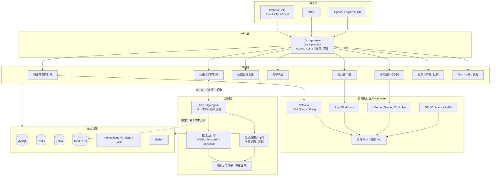
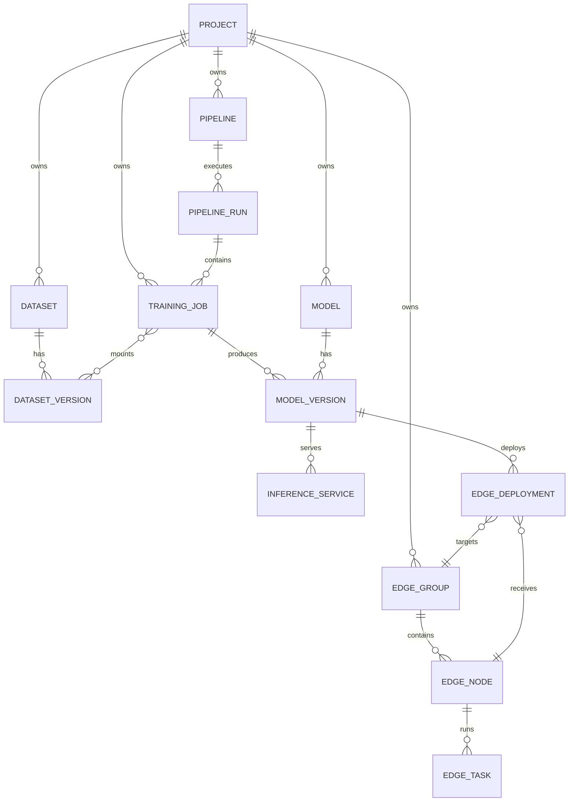
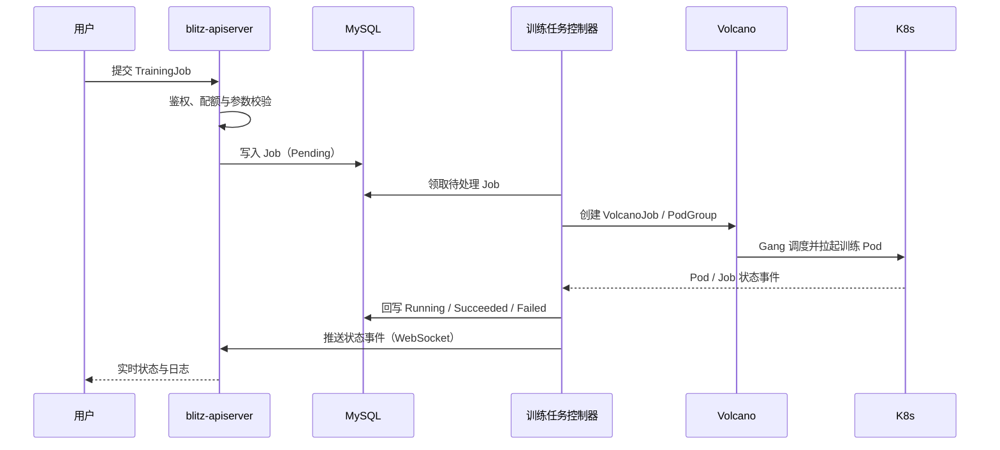
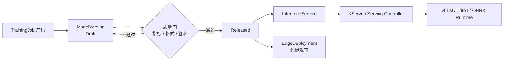
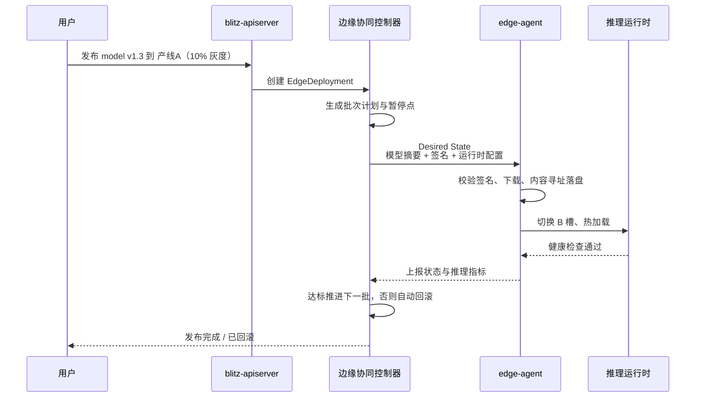
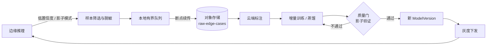
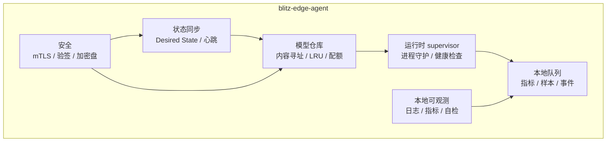

# Blitz

> 云边协同的 AI 训练与推理平台 —— 在云端完成数据、训练、模型管理与在线推理，在边缘完成模型下发、实时推理、增量训练与数据回流。


---

## 1. 项目简介

Blitz 是一个面向企业私有化场景的 **AI 训推一体化平台**。它把「数据 → 训练 → 模型 → 推理 → 边缘 → 回流」串成一条可运营的闭环：

- **云端**：数据集与版本管理、单机/分布式训练、DAG 流水线、超参搜索、模型仓库、在线推理服务、GPU 队列与配额。
- **边缘**：模型灰度下发、端侧实时推理、断网自治、边缘增量训练、难例数据回流。
- **统一控制面**：一个 Web 控制台、一套 OpenAPI、一份模型资产，云端与边缘使用同一套模型版本与发布语义。

Blitz 的云端编排底座直接继承了 [workload_manager](../hct_cloud_tools/workload_manager) 已经验证过的模式：**API 服务与 Controller 分离、Informer + WorkQueue 做状态收敛、Volcano 承载批训练、Argo Workflows 承载 DAG**。在此基础上新增了模型、推理服务、边缘协同、数据飞轮四个领域。

> 详细设计见 [docs/architecture.md](docs/architecture.md)：包含模块职责、状态机、控制器收敛机制、云边协议、数据模型、关键时序与 ADR。

### 1.1 目标场景

| 场景 | 典型诉求 | Blitz 提供 |
|------|----------|-----------|
| 算法团队日常训练 | 提交任务、看日志、调参、排队、抢卡 | Web 提交训练、实时日志、队列/配额、失败重试 |
| 多步骤训练流水线 | 数据预处理 → 训练 → 评估 → 导出 | Argo DAG 流水线、任务依赖、断点续跑 |
| 模型上线 | 版本管理、灰度、回滚、弹性伸缩 | 模型仓库、推理服务、Canary、自动回滚 |
| 产线/园区边缘推理 | 低延迟、离线可用、批量运维 | Edge Agent、模型 OTA、断网自治、设备分组 |
| 边缘数据飞轮 | 难例回流、增量训练、数据不出域 | 主动学习采样、边缘训练、模型增量回传、质量门 |
| 平台运营 | 多租户、成本、审计 | 项目隔离、RBAC、配额、计费事件、审计日志 |

### 1.2 非目标（一期）

- 不做通用 Notebook / IDE 托管平台，交互式开发通过镜像内的 Jupyter 自行解决。
- 不自研训练框架和推理引擎，训练交给 PyTorch/DeepSpeed/Megatron，推理交给 vLLM/Triton/ONNX Runtime/TensorRT。
- 不做跨公网的大规模 CDN 分发，一期使用对象存储 + 边缘本地缓存。
- 不做完整的联邦学习框架，一期只提供「边缘增量训练 + 云端聚合」的最小闭环。

---

## 2. 核心能力

| 领域 | 能力 | 说明 |
|------|------|------|
| 数据集 | 数据集、版本、血缘 | 版本不可变；记录来源、预处理脚本、父版本 |
| 训练 | 单机 / 分布式任务 | VolcanoJob 落地，支持 DDP/FSDP/DeepSpeed/Megatron |
| 训练 | 队列、配额、优先级、抢占 | 复用 Volcano Queue / PodGroup，支持 Gang Scheduling |
| 训练 | 失败重试、断点续训 | 平台级重试策略 + 用户自定义 checkpoint 恢复 |
| 流水线 | DAG 编排 | Argo Workflows，支持条件、循环、缓存、人工卡点 |
| 实验 | 超参搜索、指标对比 | 基于模板批量展开任务，指标汇总到实验视图 |
| 模型 | 模型仓库、版本、签名 | 内容寻址、不可变版本、人工/自动质量门 |
| 推理 | 在线服务、灰度、弹性 | KServe 或自研 Serving Controller，支持 vLLM/Triton/ONNX |
| 推理 | 多副本、HPA、GPU 共享 | 按 QPS/GPU 利用率扩缩容，HAMi 做显存切分 |
| 边缘 | 设备纳管、分组、标签 | 站点/产线/型号多维分组，心跳与健康度 |
| 边缘 | 模型下发与灰度 | 分批发布、暂停/继续、指标门禁、自动回滚 |
| 边缘 | 边缘推理 | ONNX Runtime / TensorRT / llama.cpp，A/B 双槽热切换 |
| 边缘 | 边缘训练 | 本地增量训练/蒸馏，原始数据不出域，只回传模型增量与指标 |
| 飞轮 | 难例回流 | 低置信度/影子模式采样，有界队列，断点续传 |
| 平台 | 多租户、RBAC、配额 | 项目即命名空间，角色授权到项目级 |
| 平台 | 可观测、审计、计费 | 任务时间线、GPU 指标、操作审计、Kafka 计费事件 |

---

## 3. 与主流产品的对照

| 能力 | 主流形态 | Blitz 的取舍 |
|------|----------|--------------|
| 云端训练 | 阿里 PAI-DLC、AWS SageMaker Training | 以 K8s + Volcano 为底座，私有化部署优先 |
| 流水线 | Kubeflow Pipelines、Argo Workflows | 直接用 Argo，不重复造 DAG 引擎 |
| 模型仓库 | MLflow Model Registry、ModelArts | 轻量自研，围绕 K8s 部署语义设计 |
| 云推理 | KServe、PAI-EAS、SageMaker Endpoint | 复用 KServe CRD，运行时适配层屏蔽引擎差异 |
| 边缘推理 | AWS Greengrass、Azure IoT Edge、KubeEdge | 单二进制 Agent，不要求边缘装 K8s |
| 边缘训练 | ModelArts Edge、FedML | 一期做增量训练 + 质量门，二期再做联邦聚合 |
| 数据飞轮 | 特斯拉影子模式、主动学习平台 | 采样、回传、标注、重训、回灌全链路可配置 |

**一句话定位**：比 Kubeflow 更贴近生产运维，比公有云 MLOps 更适合私有化与边缘场景。

---

## 4. 总体架构

### 4.1 分层视图



### 4.2 职责边界

| 组件 | 职责 | 不做什么 |
|------|------|----------|
| `blitz-apiserver` | 认证、鉴权、参数校验、CRUD、聚合查询、审计 | 不直接操作 K8s/边缘 |
| `blitz-controller` | 监听期望状态，向 K8s 与边缘收敛，回写状态 | 不对外提供业务 API |
| `blitz-edge-agent` | 执行云端期望状态，管理模型缓存、推理进程、本地训练 | 不保存全局业务状态 |
| Volcano | 批任务排队、Gang 调度、抢占 | 不感知模型与业务语义 |
| Argo Workflows | DAG 执行、重试、产物传递 | 不感知训练框架 |
| KServe / Serving Controller | 推理服务副本、路由、扩缩容 | 不管理模型版本生命周期 |

### 4.3 与 workload_manager 的继承关系

**直接复用**

- `workload-server` / `workload-controller` 的进程拆分与职责边界。
- Job / DAG 的 API 形状与状态机：创建、查询、停止、重试、删除、时间线。
- Informer + WorkQueue + Leader Election 的收敛模式。
- Job → VolcanoJob、DAG → Argo Workflow 的落地方式。
- 多 K8s 集群的 client / DAO 隔离方式。
- 基于 Kafka 的状态事件与计费事件。

**新增领域**

- 数据集与血缘、模型仓库、推理服务、边缘协同、数据飞轮。
- Web 控制台与 `blitzctl`。
- 边缘 Agent 与边缘训练运行时。

**有意简化**

- 不再区分 `computing_apiserver` 与 `workload_manager` 两个服务，一期合并为 `blitz-apiserver`，领域包内聚。
- 边缘侧不要求 K8s，Agent 是静态编译的单二进制，降低产线部署成本。
- 一期以 MySQL 为事实来源，K8s 与边缘只是期望状态的执行器，不引入大量自定义 CRD。

---

## 5. 领域模型



### 5.1 核心概念

| 概念 | 说明 | 关键字段 |
|------|------|----------|
| Project | 租户隔离单元，对应一个 K8s Namespace | 配额、成员、角色 |
| Dataset / DatasetVersion | 数据集与不可变版本 | URI、格式、大小、校验和、血缘 |
| TrainingJob | 一次训练任务 | 镜像、命令、资源、队列、数据集、输出模型 |
| Pipeline / PipelineRun | DAG 模板与一次执行 | 节点、依赖、参数、产物、状态 |
| Model / ModelVersion | 模型与不可变版本 | 框架、格式、产物 URI、指标、签名、质量门 |
| InferenceService | 云端推理服务 | 模型版本、运行时、副本、流量策略 |
| EdgeGroup | 边缘设备分组 | 站点、产线、标签选择器 |
| EdgeNode | 一台边缘设备 | 证书、心跳、资源、在线状态、模型清单 |
| EdgeDeployment | 一次边缘模型发布 | 目标分组、批次、门禁指标、回滚策略 |
| EdgeTask | 边缘训练/采集任务 | 数据切片、训练配置、资源上限 |
| Quota / Queue | 资源配额与调度队列 | GPU 型号、数量、优先级、抢占策略 |

### 5.2 状态机

| 对象 | 状态流转 |
|------|----------|
| DatasetVersion | `Creating → Validating → Ready / Failed`；`Ready` 可废弃为 `Deprecated` |
| TrainingJob | `Pending → Queuing → Initializing → Running → Succeeded / Failed / Stopped`；停止、超时或抢占经 `Terminating` 清理后进入 `Stopped`；平台失败在重试额度内可回 `Queuing`，重试生成新 Attempt |
| PipelineRun | `Pending → Running ⇄ Paused → Succeeded / Failed / Stopped`，`Failed` 可按节点重跑回 `Running` |
| ModelVersion | `Draft → Validating → Validated → Released → Deprecated`，校验失败或人工拒绝为 `Rejected`，发布后不可变 |
| InferenceService | `Creating → Ready ⇄ Updating / Degraded → Stopped` |
| EdgeNode | `Registering → Online → Degraded → Offline → Decommissioned` |
| EdgeDeployment | `Pending → RollingOut ⇄ Paused → Succeeded / RolledBack / Failed` |
| EdgeTask | `Pending → Dispatched → Running → Succeeded / Failed / Canceled` |

完整状态转换的触发条件、守卫与副作用见 [docs/domain-model.md](docs/domain-model.md)。

---

## 6. 核心流程

### 6.1 云端训练



要点：

- **幂等**：控制器以 `job.id + generation` 为幂等键，重复 reconcile 不重复建资源。
- **可观测**：Job 时间线记录每一次状态变化、调度失败原因、重试次数。
- **可恢复**：Controller 重启后通过 Informer 全量对齐，不依赖内存状态。
- **失败语义**：区分「平台失败」（镜像拉取、调度失败）与「业务失败」（训练脚本退出非 0）。

### 6.2 模型到推理服务



模型产物统一存放对象存储，`ModelVersion` 只记录 URI、摘要、格式与指标。推理服务与边缘发布引用的是同一个不可变版本，保证「云上验证过的就是边缘运行的」。

### 6.3 模型下发到边缘（云边协同）



关键设计：

- **内容寻址**：模型文件按 `sha256` 存储，天然去重，天然可校验。
- **A/B 双槽**：新版本先写入备用槽，健康检查通过后原子切换，失败立即切回。
- **签名验证**：模型清单由云端私钥签名，Agent 用内置公钥验签，防止中间人替换。
- **批次门禁**：错误率、P99 延迟、推理成功率任一超阈值即暂停并回滚。
- **断点续传**：大模型分片下载，支持 Range 请求与本地缓存复用。

### 6.4 边缘数据飞轮与边缘训练



边缘训练提供三种模式，按数据敏感度选择：

| 模式 | 数据位置 | 回传内容 | 适用场景 |
|------|----------|----------|----------|
| A. 云端训练，边缘推理 | 云端 | 无 | 默认模式，数据可上云 |
| B. 边缘增量训练 | 边缘 | 模型增量 + 指标 | 数据不出域、产线隐私 |
| C. 联邦聚合（二期） | 边缘 | 梯度/模型增量 | 多站点协同、合规要求高 |

模式 B 的执行约束：

- 只允许在小模型或微调场景启用，资源上限由 `EdgeTask` 声明，超限即拒绝。
- 训练数据切片由云端按时间窗和采样策略下发，原始样本不离开边缘。
- 回传的模型增量先进入影子环境验证，通过质量门后才进入灰度发布。
- 边缘训练失败不影响线上推理，Agent 保证推理进程与训练进程资源隔离。

### 6.5 断网与弱网

边缘 Agent 以「**期望状态 + 本地缓存**」运行，不依赖实时连接：

1. 在线时定期拉取 Desired State，并缓存最近 N 个版本。
2. 断网后继续按最后一次期望状态推理，指标与样本写入本地磁盘队列。
3. 网络恢复后按优先级回传：告警 > 发布状态 > 指标 > 样本。
4. 本地磁盘设有水位线，超过阈值按 LRU 丢弃低价值样本并计数，绝不阻塞推理。
5. 云端将超过心跳阈值的设备标记为 `Offline`，但不会自动下发破坏性操作。

---

## 7. 边缘侧设计

### 7.1 Edge Agent 组成



### 7.2 部署形态

- **单二进制**：Go 静态编译，支持 `amd64` / `arm64`，以 systemd 服务或容器方式运行。
- **最小依赖**：不要求边缘安装 K8s、Docker、数据库；运行时按需内置或外挂。
- **资源约束**：可配置 CPU/内存/显存上限，推理与训练使用独立 cgroup。
- **自升级**：Agent 自身也走 A/B 槽与签名校验，升级失败自动回退。

### 7.3 运行时适配

| 运行时 | 适用 | 接入方式 |
|--------|------|----------|
| ONNX Runtime | 通用 CV/小模型 | 进程内或 sidecar |
| TensorRT | NVIDIA 边缘盒子 | 进程内，按设备型号编译引擎 |
| llama.cpp | 边缘 LLM | 独立进程，HTTP/gRPC |
| 自定义 | 厂商私有 SDK | 实现 `Runtime` 接口并注册 |

运行时通过统一接口接入：`Load(model) / Infer(request) / Health() / Unload()`，平台不绑定具体引擎。

---

## 8. 技术栈

| 层次 | 选型 | 说明 |
|------|------|------|
| 后端语言 | Go 1.22+ | 与 workload_manager 保持一致 |
| HTTP / RPC | Gin + protobuf + gRPC-Gateway | 一份 proto 生成 REST 与 gRPC |
| 控制器 | client-go Informer + WorkQueue + Leader Election | 复用成熟收敛模式 |
| 依赖注入 / Mock | wire / mockgen | 与参考项目一致 |
| 编排 | Kubernetes 1.28+、Volcano、Argo Workflows | 批训练与 DAG |
| 推理 | KServe、vLLM、Triton、ONNX Runtime、TensorRT-LLM | 按场景选择 |
| GPU 共享 | HAMi + GPU Operator | 显存切分与设备管理 |
| 训练框架 | PyTorch、DeepSpeed、FSDP、Megatron-LM | 平台只负责拉起与编排 |
| 超参搜索 | 自研模板展开（一期）、Ray Tune（可选） | 避免过早引入重依赖 |
| 存储 | MySQL 8、Redis、MinIO/S3、JuiceFS（可选） | 元数据、缓存、产物、共享存储 |
| 消息 | Kafka | 状态事件、计费事件、异步任务 |
| 前端 | React 18 + TypeScript + Ant Design Pro + Vite + ECharts | 控制台 |
| 可观测 | Prometheus、Grafana、Loki、OpenTelemetry、DCGM | 指标、日志、链路、GPU |
| 部署 | Helm、Docker、Harbor、Argo CD | 私有化交付 |
| 边缘 | Go Agent、ONNX Runtime、TensorRT、llama.cpp | 单二进制 + 可插拔运行时 |

---

## 9. 仓库结构

```text
Blitz/
├── cmd/
│   ├── apiserver/            # 统一 API 入口
│   ├── controller/           # 训练 / 推理 / 边缘控制器
│   └── edge-agent/           # 边缘代理
├── api/
│   └── v1/                   # protobuf 定义与生成代码
├── internal/
│   ├── auth/                 # 认证、RBAC
│   ├── project/              # 项目与租户
│   ├── dataset/              # 数据集与血缘
│   ├── job/                  # 训练任务
│   ├── pipeline/             # DAG 流水线
│   ├── experiment/           # 实验与超参搜索
│   ├── model/                # 模型仓库
│   ├── serving/              # 推理服务
│   ├── edge/                 # 边缘纳管、发布、任务
│   ├── flywheel/             # 样本回流与训练闭环
│   ├── quota/                # 配额与队列
│   └── audit/                # 审计与计费
├── dao/                      # 持久化实现
├── model/                    # 领域实体
├── pkg/                      # 通用库：client、notify、metrics、utils
├── web/                      # Web 控制台
├── edge/
│   ├── runtime/              # 边缘运行时适配
│   └── trainer/              # 边缘增量训练脚本与镜像
├── deploy/
│   ├── helm/                 # 云端 Helm Chart
│   ├── edge/                 # 边缘安装包与 systemd unit
│   └── manifests/            # Volcano / Argo / KServe 依赖
├── docs/
├── examples/
│   ├── jobs/                 # 训练任务示例
│   ├── pipelines/            # 流水线示例
│   └── edge/                 # 边缘发布示例
├── Makefile
└── README.md
```

---

## 10. API 概览

统一前缀 `/api/v1`，REST 与 gRPC 由同一份 proto 生成。

| 资源 | 方法与路径 | 说明 |
|------|-----------|------|
| 项目 | `GET/POST /projects` | 项目与成员管理 |
| 数据集 | `POST /projects/{p}/datasets` | 创建数据集 |
| 数据集版本 | `POST /datasets/{id}/versions` | 注册不可变版本 |
| 训练任务 | `POST /projects/{p}/jobs` | 提交训练 |
| 训练任务 | `GET /jobs/{id}`、`POST /jobs/{id}:stop`、`POST /jobs/{id}:retry` | 查询、停止、重试 |
| 训练日志 | `GET /jobs/{id}/logs?follow=true` | 流式日志 |
| 流水线 | `POST /projects/{p}/pipelines`、`POST /pipelines/{id}/runs` | 模板与执行 |
| 模型 | `POST /projects/{p}/models`、`POST /models/{id}/versions` | 模型与版本 |
| 模型发布 | `POST /model-versions/{id}:release` | 通过质量门并发布 |
| 推理服务 | `POST /projects/{p}/services`、`PATCH /services/{id}` | 创建、更新 |
| 边缘分组 | `POST /projects/{p}/edge-groups` | 设备分组 |
| 边缘发布 | `POST /projects/{p}/edge-deployments` | 灰度下发 |
| 边缘发布 | `POST /edge-deployments/{id}:pause`、`:resume`、`:rollback` | 发布控制 |
| 边缘任务 | `POST /edge-nodes/{id}/tasks` | 边缘训练/采集 |
| Agent 心跳 | `POST /edge/agents/{id}/heartbeat` | 状态与指标上报 |
| Agent 期望状态 | `GET /edge/agents/{id}/desired-state` | 拉取期望状态 |

鉴权使用 Bearer Token / OIDC，所有写操作记录审计；Agent 使用独立设备证书与 mTLS 通道。

---

## 11. 配置示例

### 11.1 训练任务

```yaml
apiVersion: blitz.io/v1alpha1
kind: TrainingJob
metadata:
  name: qwen-sft-0713
  project: llm-platform
spec:
  image: harbor.example.com/blitz/pytorch:2.4-cu121
  command:
    - torchrun
    - --nproc_per_node=8
    - train.py
    - --config=/workspace/config/sft.yaml
  resources:
    gpu: 8
    gpuType: A100-80G
    cpu: 64
    memory: 512Gi
  queue: gpu-a100
  datasets:
    - name: sft-corpus
      version: v12
      mountPath: /data/sft
  outputs:
    modelName: qwen2.5-7b-sft
  retry:
    maxRetries: 3
    backoffSeconds: 60
  ttlSecondsAfterFinished: 604800
```

### 11.2 边缘灰度发布

```yaml
apiVersion: blitz.io/v1alpha1
kind: EdgeDeployment
metadata:
  name: defect-det-v1-3-rollout
  project: cv-platform
spec:
  model:
    name: defect-det
    version: v1.3.0
  target:
    group: line-a
    selector:
      matchLabels:
        site: suzhou
  strategy:
    type: Canary
    batches: ["10%", "50%", "100%"]
    pauseBetweenBatches: 10m
    autoRollback:
      maxErrorRate: 0.01
      maxLatencyP99Ms: 45
      minSamples: 1000
  runtime:
    name: onnxruntime
    device: cuda
    resources:
      cpu: 2
      memory: 4Gi
      gpuMemory: 2Gi
  sampling:
    enabled: true
    lowConfidenceRange: [0.40, 0.75]
    maxQueueSize: 20000
    uploadRatePerSecond: 50
```

### 11.3 边缘训练任务

```yaml
apiVersion: blitz.io/v1alpha1
kind: EdgeTask
metadata:
  name: defect-det-incremental-0713
  project: cv-platform
spec:
  type: IncrementalTraining
  target:
    group: line-a
  baseModel:
    name: defect-det
    version: v1.2.0
  data:
    source: local-flywheel
    windowHours: 24
    maxSamples: 5000
  resources:
    cpu: 4
    memory: 8Gi
    gpuMemory: 4Gi
  output:
    uploadDelta: true
    uploadMetrics: true
  qualityGate:
    minAccuracy: 0.95
    maxRegression: 0.01
```

---

## 12. 部署形态

| 形态 | 说明 | 适用 |
|------|------|------|
| 单集群私有化 | 一个 K8s 集群承载控制面与执行面 | 中小规模、POC |
| 多集群 | 控制面集中，执行面按地域/业务拆分 | 多机房、GPU 资源分散 |
| 云边一体 | 云端控制面 + 边缘 Agent 直连 | 产线、园区、门店 |
| 边缘网关模式 | 边缘网关代理多台设备，减少长连接数 | 设备数量大、网络受限 |
| 纯边缘离线 | Agent 离线运行，人工导入模型包 | 无公网、强隔离环境 |

控制面组件均可多副本部署：API 无状态，Controller 通过 Leader Election 选主，MySQL 主从，Redis/Kafka 高可用。

---

## 13. 安全与多租户

- **身份**：OIDC / LDAP 登录，JWT 短期令牌；服务间使用 Service Account。
- **授权**：项目级 RBAC（Owner / Maintainer / Developer / Viewer），K8s Namespace 隔离。
- **配额**：按项目限制 GPU 型号与数量、并发 Job 数、存储容量、边缘设备数。
- **数据**：传输 TLS，静态加密可选 KMS/Vault；数据集与模型访问受项目边界约束。
- **供应链**：镜像 cosign 签名与 SBOM；模型清单 Ed25519 签名；Harbor 漏洞扫描。
- **边缘**：一机一证，mTLS；模型验签后才加载；本地磁盘可加密；Agent 最小权限运行。
- **审计**：所有写操作、发布、回滚、权限变更写入审计日志，可按项目与用户检索。

---

## 14. 可观测性

| 维度 | 指标 | 展示 |
|------|------|------|
| 训练 | 任务数、排队时长、GPU 利用率、失败率、重试次数 | 项目大盘、Job 时间线 |
| 推理 | QPS、P50/P99、错误率、显存、副本数 | 服务大盘、告警 |
| 边缘 | 在线率、心跳延迟、模型版本分布、磁盘水位 | 设备地图、分组视图 |
| 飞轮 | 采样量、上传成功率、丢弃数、标注进度 | 飞轮健康度 |
| 平台 | API 延迟、错误率、Controller 队列深度 | 平台自身 SLO |

日志统一进入 Loki，指标进入 Prometheus，GPU 指标由 DCGM Exporter 采集，关键链路接入 OpenTelemetry。

---

## 15. 路线图

| 阶段 | 目标 | 交付物 | 验收标准 |
|------|------|--------|----------|
| M0 骨架 | 可运行的平台底座 | API、DB、登录、项目、K8s 接入、控制台壳 | 能创建项目并看到集群资源 |
| M1 云训练 MVP | 单机/分布式训练闭环 | 提交 → Volcano → 日志 → 停止/重试 | 一个 ResNet/Qwen 任务端到端跑通 |
| M2 流水线与模型 | 多步骤与资产管理 | Argo DAG、模型仓库、质量门 | 数据→训练→评估→发布全自动 |
| M3 云推理 | 在线服务闭环 | 推理服务、灰度、HPA、运行时适配 | 模型版本一键上线并可回滚 |
| M4 边缘推理 | 云边协同 MVP | Edge Agent、设备纳管、模型 OTA、灰度 | 边缘断网可推理，发布可回滚 |
| M5 边缘训练与飞轮 | 数据闭环 | 难例回流、边缘增量训练、云端聚合 | 一次「边缘采样→云端重训→回灌」闭环 |
| M6 企业化 | 可运营 | 多租户、配额、计费、审计、HA、Helm 交付 | 通过安全与稳定性验收 |

---

## 16. 快速开始（规划）

> M0 完成后可用；以下命令为目标形态。

```bash
# 1. 准备依赖（kind + Volcano + Argo + MinIO + MySQL + Redis）
make dev-up

# 2. 初始化数据库与示例数据
make migrate
make seed

# 3. 启动控制面
make run-apiserver
make run-controller

# 4. 启动前端
cd web && npm install && npm run dev

# 5. 提交一个示例训练任务
blitzctl job create -f examples/jobs/hello-pytorch.yaml

# 6. 查看状态与日志
blitzctl job list
blitzctl job logs hello-pytorch -f
```

边缘 Agent：

```bash
# 边缘设备上安装（以 systemd 为例）
sudo ./blitz-edge-agent install \
  --server https://blitz.example.com \
  --token <bootstrap-token> \
  --data-dir /var/lib/blitz

sudo systemctl enable --now blitz-edge-agent
blitz-edge-agent status
```

---

## 17. 关键设计取舍

| 决策 | 选择 | 原因 | 代价 |
|------|------|------|------|
| 事实来源 | MySQL 为准，K8s/边缘为执行器 | 查询与事务简单，便于审计 | 需要控制器保证最终一致 |
| 云边通信 | Agent 主动拉取 + 长连接推送 | 穿透 NAT，弱网友好 | 状态有秒级延迟 |
| 边缘形态 | 单二进制，不依赖 K8s | 产线部署成本低 | 无法复用 K8s 生态 |
| 模型分发 | 内容寻址 + 对象存储 | 去重、校验、断点续传 | 需要本地缓存治理 |
| 边缘训练 | 数据不出域，只回传增量 | 隐私与合规 | 云端无法直接看原始样本 |
| DAG 引擎 | 直接用 Argo | 成熟、生态好 | 引入额外组件与学习成本 |
| 资源调度 | 委托 Volcano | 不重复造调度器 | 受 Volcano 能力边界约束 |
| 边缘编排 | 不用 KubeEdge | 降低边缘复杂度 | 大规模设备管理需自研 |

---

## 18. 文档索引

| 文档 | 状态 | 内容 |
|------|------|------|
| [docs/architecture.md](docs/architecture.md) | 已完成 | 总体架构、模块交互、状态机、云边协议、数据模型、ADR |
| [docs/domain-model.md](docs/domain-model.md) | 已完成 | 领域模型、状态机、表结构、索引、事务边界、归档策略 |
| `docs/api.md` | 规划中 | OpenAPI / proto 说明与错误码 |
| `docs/edge.md` | 规划中 | Edge Agent 协议、发布流程、故障处理 |
| `docs/flywheel.md` | 规划中 | 采样策略、数据格式、质量门 |
| `docs/deployment.md` | 规划中 | Helm 参数、多集群、离线安装 |
| `docs/operations.md` | 规划中 | 监控、告警、容量规划、排障手册 |

---

## 19. 贡献与许可证

- 提交前请运行 `make lint && make test`。
- 新增领域包需附带单元测试与示例 YAML。
- 本项目采用 [Apache License 2.0](./LICENSE)。

---

**Blitz** —— 让模型从云端训练到边缘推理，成为一条可运营的流水线。
