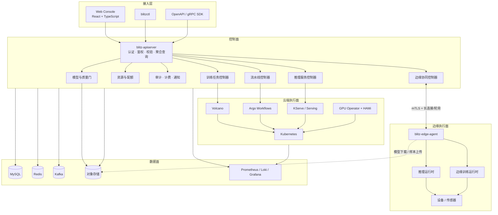
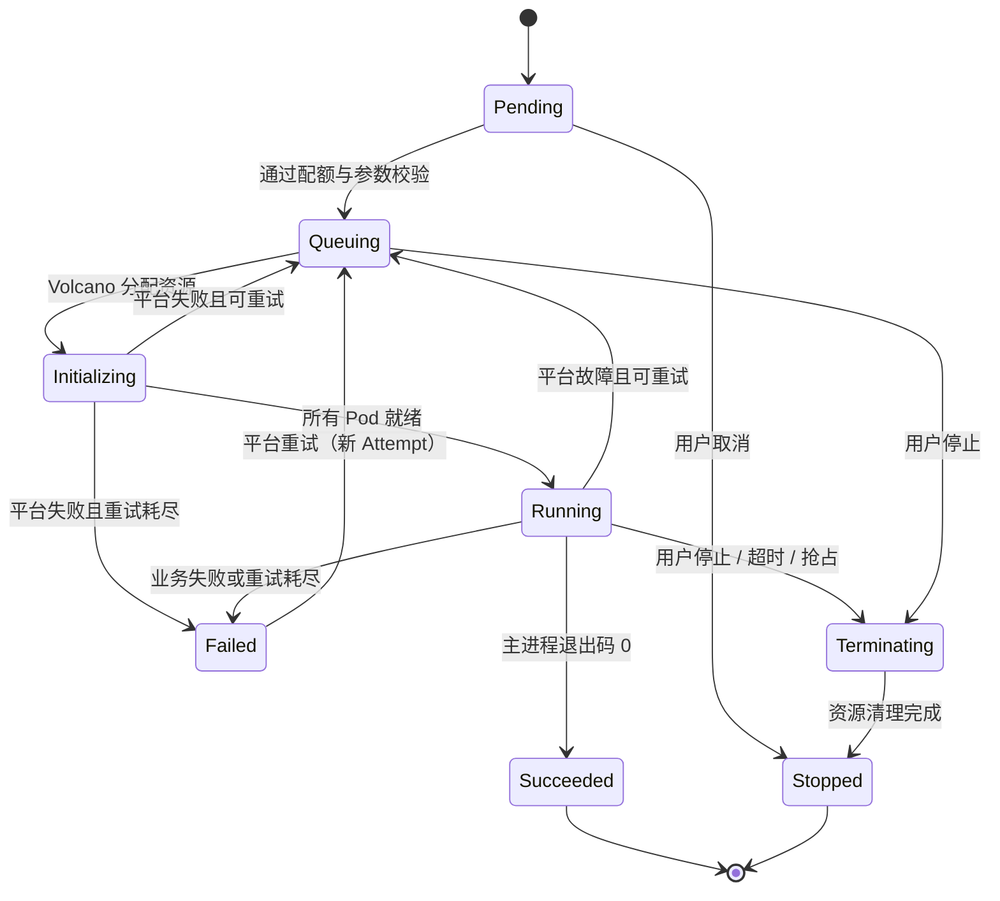
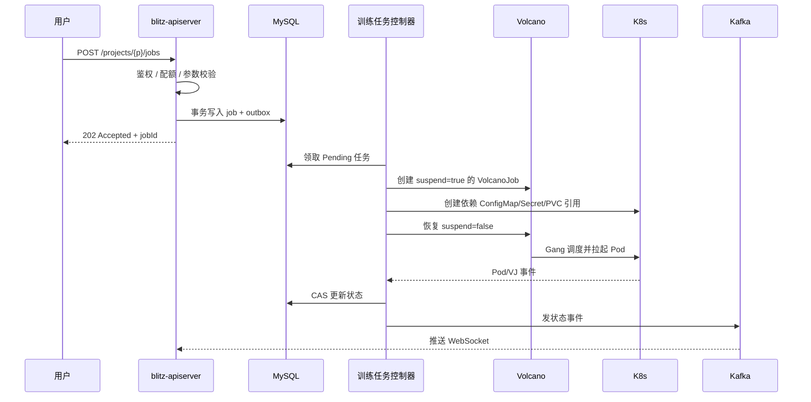
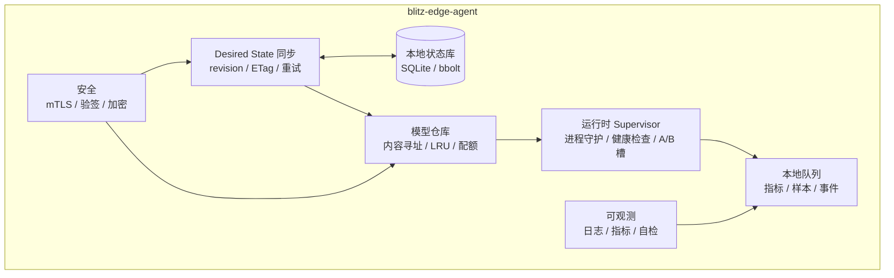
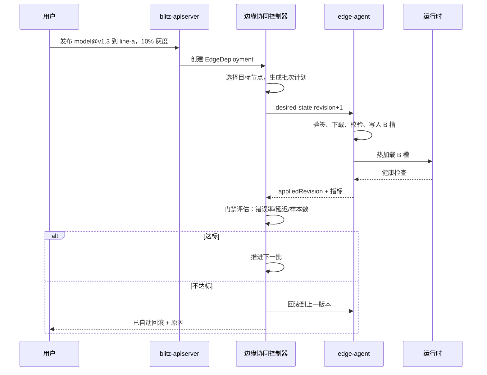
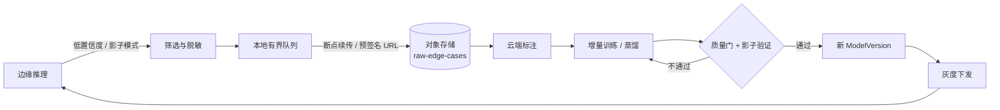
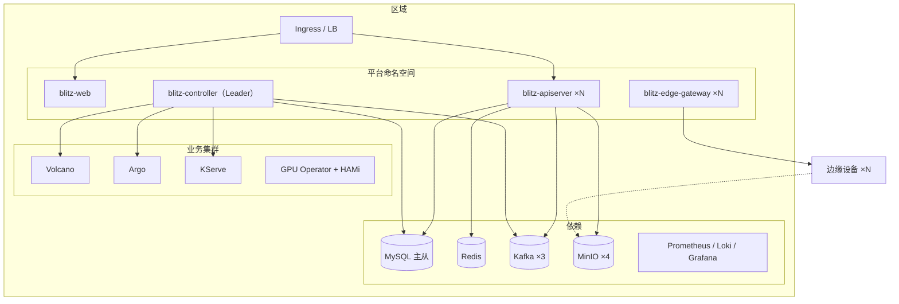

# Blitz 整体设计文档

| 项目 | 内容 |
|------|------|
| 文档版本 | v0.1 |
| 状态 | 已完成 |
| 适用阶段 | M0 ～ M6 |
| 读者 | 平台研发、SRE、算法接入方、边缘交付团队 |
| 关联文档 | [README](../README.md)、[domain-model.md](domain-model.md)、`docs/api.md`、`docs/edge.md` |

---

## 目录

- [1. 背景与目标](#1-背景与目标)
- [2. 设计原则](#2-设计原则)
- [3. 总体架构](#3-总体架构)
- [4. 与 workload_manager 的关系](#4-与-workload_manager-的关系)
- [5. 领域设计](#5-领域设计)
- [6. 关键机制](#6-关键机制)
- [7. 数据模型](#7-数据模型)
- [8. API 设计](#8-api-设计)
- [9. 部署设计](#9-部署设计)
- [10. 风险与对策](#10-风险与对策)
- [11. 演进路线](#11-演进路线)
- [12. 设计决策记录（ADR）](#12-设计决策记录adr)
- [13. 待定问题](#13-待定问题)
- [附录 A：术语表](#附录-a术语表)
- [附录 B：与 workload_manager 代码映射](#附录-b与-workload_manager-代码映射)

---

## 1. 背景与目标

### 1.1 问题陈述

`workload_manager` 已经解决了云上训练任务与 DAG 的核心编排问题：Job/DAG 的提交、排队、状态收敛、Volcano/Argo 落地、多集群隔离、计费事件。但它本质上是一个**计算任务管理器**，不是完整的 AI 训推平台，缺少四块能力：

1. **模型资产**：训练产物没有版本、签名、血缘与质量门，推理侧无法可靠引用。
2. **推理服务**：没有服务生命周期、灰度、弹性伸缩与运行时适配。
3. **边缘协同**：没有设备纳管、模型分发、断网自治与边缘训练。
4. **数据闭环**：边缘产生的难例无法回流，模型无法持续变好。

Blitz 的目标是在 `workload_manager` 的经验之上，补齐这四块，形成「**数据 → 训练 → 模型 → 推理 → 边缘 → 回流**」的完整平台。

### 1.2 设计目标

| 编号 | 目标 | 可验证结果 |
|------|------|-----------|
| G1 | 云端训推一体 | 同一个 `ModelVersion` 既能部署为云推理服务，也能下发到边缘 |
| G2 | 云边同一套发布语义 | 云端 Canary 与边缘分批发布共享「版本、门禁、回滚」模型 |
| G3 | 弱网/离线可用 | 边缘断网后继续推理，恢复后自动补报状态与样本 |
| G4 | 多租户可运营 | 项目隔离、RBAC、GPU 配额、审计、计费事件 |
| G5 | 可演进 | 训练/推理/边缘运行时均可插拔，不绑定单一引擎 |
| G6 | 可运维 | 状态收敛可观测，故障可定位，Controller 可安全重启 |

### 1.3 非目标

- 不在平台内实现训练框架、推理引擎或模型格式转换器。
- 不要求边缘设备安装 Kubernetes。
- 一期不实现完整的联邦学习协议，只做「边缘增量训练 + 云端聚合」。
- 不提供通用 Notebook/IDE，交互式开发由镜像自带的 Jupyter 承担。
- 不做跨公网的大规模 CDN；模型分发依赖对象存储与边缘缓存。

### 1.4 质量属性

| 属性 | 目标 | 说明 |
|------|------|------|
| 可用性 | 控制面 99.9% | 单集群；边缘断网不影响本地推理 |
| 状态收敛 | 云端任务 < 10s，边缘 < 60s | P95，网络正常时 |
| API 延迟 | 读 P99 < 300ms，写 P99 < 500ms | 不含大文件上传 |
| 规模 | 单区域 10k 边缘节点、5k 并发推理副本、500 并发训练任务 | 见 §6.8 |
| 数据可靠性 | RPO ≤ 15min，RTO ≤ 2h | 云端元数据；边缘保留 last-known-good |
| 安全 | 全链路 TLS、模型验签、最小权限 | 见 §6.5 |

---

## 2. 设计原则

1. **单一事实来源**：MySQL 保存期望状态与业务状态；K8s、Volcano、Argo、边缘设备都是执行器。控制器负责把期望状态收敛为实际状态。
2. **期望状态收敛**：所有长生命周期对象都采用 `Spec → Reconcile → Status` 模式，控制器可重复执行、可安全重启。
3. **资产不可变**：数据集版本、模型版本、镜像摘要一经发布不可修改；变更产生新版本。
4. **边缘自治**：边缘以最后一次成功的期望状态运行，云端不可用时不影响本地推理。
5. **复用成熟组件**：调度用 Volcano，DAG 用 Argo，推理用 KServe/主流运行时，GPU 共享用 HAMi，不重复造轮子。
6. **可观测优先**：每个对象都有状态、事件、时间线与指标；每个控制器都有收敛延迟与队列深度指标。
7. **渐进演进**：先打通单集群训推闭环，再扩展边缘与多集群；接口预留扩展点，但不提前实现。

---

## 3. 总体架构

### 3.1 逻辑分层



### 3.2 平面划分

| 平面 | 组成 | 职责 | 故障影响 |
|------|------|------|----------|
| 接入平面 | Web、CLI、SDK、API | 用户交互、认证、限流 | 不影响已运行任务与边缘推理 |
| 控制平面 | 各领域 Controller、调度策略、质量门 | 期望状态收敛 | 已运行负载继续，新操作延迟 |
| 执行平面 | K8s、Volcano、Argo、KServe、GPU | 实际算力与运行时 | 影响对应集群/设备 |
| 数据平面 | MySQL、Redis、Kafka、对象存储 | 元数据、事件、模型与样本 | 影响控制面与数据回流 |
| 边缘平面 | Edge Agent、运行时、设备 | 本地推理与训练 | 云端故障时仍可自治 |

### 3.3 进程与部署单元

| 单元 | 形态 | 副本 | 说明 |
|------|------|------|------|
| `blitz-apiserver` | Deployment | ≥2，无状态 | REST/gRPC、认证、聚合查询、审计 |
| `blitz-controller` | Deployment | 每集群 1 主（Leader Election） | 训练/推理/边缘/资源控制器 |
| `blitz-edge-gateway` | Deployment | 可选，按设备规模扩展 | 代理大量边缘长连接，降低 API 压力 |
| `blitz-web` | Deployment + Nginx | ≥2 | 静态资源与控制台 |
| `blitz-edge-agent` | systemd / 容器 | 每设备 1 | 期望状态执行、模型缓存、运行时守护 |
| MySQL | 主从 / 云数据库 | 1 主 ≥1 从 | 事实来源 |
| Redis | Sentinel / Cluster | ≥3 | 缓存、分布式锁、限流 |
| Kafka | 3 Broker | ≥3 | 状态事件、计费事件、异步任务 |
| 对象存储 | MinIO / S3 | ≥4 节点 | 数据集、模型、样本、日志归档 |

### 3.4 关键数据流

1. **训练**：API 写 DB → 训练控制器建 VolcanoJob → K8s 拉起 Pod → 状态回写 DB → 事件推送前端。
2. **模型**：训练输出上传对象存储 → 生成 `ModelVersion` → 质量门 → `Released`。
3. **云推理**：`InferenceService` 引用 `ModelVersion` → 推理控制器建 KServe/Deployment → 流量接入。
4. **边缘推理**：`EdgeDeployment` → 边缘控制器生成发布计划 → Agent 拉取期望状态 → 下载/验签/切换 → 上报。
5. **数据飞轮**：边缘采样 → 对象存储 → 云端标注 → 训练 → 质量门 → 新版本 → 灰度回灌。
6. **事件**：DB 事务内写 Outbox → Relay 发 Kafka → 通知/计费/审计消费。

---

## 4. 与 workload_manager 的关系

### 4.1 直接复用

| workload_manager 实践 | Blitz 的继承方式 |
|-----------------------|------------------|
| `workload-server` / `workload-controller` 分离 | `blitz-apiserver` / `blitz-controller` 分离 |
| Job/DAG 的 API 与状态机 | 保留语义，扩展模型、服务、边缘字段 |
| Informer + WorkQueue + Leader Election | 抽象为通用 `Reconciler` 框架 |
| Job → VolcanoJob、DAG → Argo Workflow | 保持不变，作为执行后端 |
| 多集群 client/DAO 隔离 | 保留每集群独立 K8s client 与 Controller；一期元数据统一存储，按 cluster 字段隔离 |
| Kafka 计费事件 + 去重缓存 + 优雅退出 | 保留，扩展为通用 Outbox/Event Bus |
| 环境变量卸载到 ConfigMap | 保留，降低 Informer 序列化压力 |
| 核心资源 protobuf 传输 | 保留，减少 API Server 序列化开销 |
| 8 位错误码 | 保留编码思想，重新划分业务域 |
| 任务超时/卡死巡检（延迟队列） | 保留，扩展为通用 `TimedReconciler` |
| 失败原因分类、重试轮次注解 | 保留，纳入 Job 状态机 |

### 4.2 演进与差异

| 维度 | workload_manager | Blitz |
|------|------------------|-------|
| 领域范围 | 训练/数据处理任务 | 数据、训练、模型、推理、边缘、飞轮 |
| 状态来源 | MySQL + K8s 状态 | MySQL 为唯一事实来源，K8s/边缘为执行器 |
| 资源抽象 | Job/DAG | Project、Dataset、Model、Service、EdgeDeployment 等 |
| 边缘 | 无 | 单二进制 Agent + 期望状态协议 |
| 用户界面 | 无（由上游 apiserver 提供） | 自带 Web 控制台与 CLI |
| 服务拆分 | 两个服务 | 一期合并为一个 API 服务，领域包内聚 |
| 扩展方式 | 修改 Job 字段 | 运行时适配器、质量门策略、领域插件 |

### 4.3 兼容策略

- 保留 Job/DAG 的核心字段与状态名，降低老用户迁移成本。
- 提供 `internal/legacy` 适配层，把旧 Job 请求映射到新 `TrainingJob`。
- 迁移期允许新旧 API 并存，写路径统一落到新表；读路径按开关回退。
- 旧数据通过一次性迁移工具导入，迁移前后以 `job_id` 对齐。

---

## 5. 领域设计

### 5.1 项目与租户

- **Project 即租户边界**：一个 Project 对应一个 K8s Namespace（云端）与一组边缘分组。
- **成员与角色**：`Owner`、`Maintainer`、`Developer`、`Viewer`，权限按项目授予。
- **配额挂在 Project 上**：GPU 型号/数量、CPU/内存、存储、并发任务数、边缘设备数。
- **隔离**：K8s Namespace + NetworkPolicy + 对象存储前缀 + 数据库 `project_id` 过滤。

### 5.2 数据集

**模型**

```text
Dataset
  └── DatasetVersion（不可变）
        ├── manifest.json      文件列表、校验和、格式
        ├── schema.json        字段与标注规范（可选）
        └── files/...          实际数据
```

- 版本一经创建不可修改；新增数据产生新版本。
- 支持引用外部存储（S3/JuiceFS/NFS），平台只记录 URI 与校验和。
- 血缘记录：来源、父版本、预处理流水线、使用该版本训练出的模型。
- 训练任务挂载数据集时，只读挂载并校验 manifest 摘要。

### 5.3 训练任务

#### 5.3.1 资源模型

```yaml
kind: TrainingJob
spec:
  image: string
  command: []string
  env: []EnvVar
  roles:                      # 分布式角色
    - name: master
      replicas: 1
    - name: worker
      replicas: 7
  resources:
    gpu: int
    gpuType: string
    cpu: string
    memory: string
  queue: string
  priority: low|medium|high|urgent|highest
  datasets: []DatasetMount
  volumes: []Volume
  outputs: []ModelOutput
  retry: {maxRetries, backoffSeconds}
  timeoutSeconds: int
  ttlSecondsAfterFinished: int
```

#### 5.3.2 状态机



状态规则：

- **单调性**：`Succeeded`、`Stopped` 以及不可再重试的 `Failed` 为终态；`Failed` 在重试额度内可回到 `Queuing`，重试创建新的 `attempt`，不修改历史记录。
- **平台失败 vs 业务失败**：镜像拉取、调度失败、节点故障属于平台失败，可自动重试；训练脚本非 0 退出属于业务失败，默认不自动重试。
- **超时**：`timeoutSeconds` 到点进入 `Terminating`，由延迟队列兜底，防止事件丢失导致任务悬挂。
- **清理**：终态后按 TTL 删除 Pod/VolcanoJob；DB 记录保留用于审计与计费。

#### 5.3.3 提交与收敛



实现要点（借鉴 `workload_manager`）：

- **先建后放行**：先创建 `suspend=true` 的 VolcanoJob，依赖资源就绪后再置为 `false`，避免 Pod 抢跑。
- **幂等创建**：`AlreadyExists` 视为成功，并从 Informer/Lister 回读实际对象。
- **CAS 更新**：`UPDATE jobs SET phase=?, version=version+1 WHERE id=? AND version=?`，冲突则重新入队。
- **索引器**：按 `job_id`、`namespace`、`phase` 建索引，避免全量扫描。
- **多队列**：`jobQueue`、`podQueue`、`vjQueue`、`delayedRunning`、`delayedTerminating` 分离，防止慢任务阻塞快路径。
- **Resync**：20～30 分钟兜底对齐，处理事件丢失。
- **Leader Election**：每个 K8s 集群一个 Controller 主实例，避免重复建资源。

#### 5.3.4 调度与执行

- **队列**：Project 绑定 Volcano Queue；队列有配额、优先级、回收策略。
- **Gang Scheduling**：分布式任务必须所有角色同时满足才启动，避免半启动浪费 GPU。
- **优先级与抢占**：映射到 K8s `PriorityClass`；高优先级可抢占低优先级，被抢占任务重新排队。
- **GPU 共享**：HAMi 提供显存切分；训练任务默认整卡，推理任务可申请 `gpuMemory` 切片。
- **节点选择**：支持 `nodeSelector`、亲和性、容忍；平台注入 GPU 型号与队列标签。
- **数据挂载**：PVC/对象存储 CSI/JuiceFS；挂载失败视为平台失败并可重试。

#### 5.3.5 重试、超时与清理

- 每次重试生成一条 `job_attempts` 记录，`attempt_no` 递增，并在外部资源上记录 `retry-round` 注解，便于日志与计费区分。
- 指数退避：`backoff = min(base * 2^n, max)`，默认 60s 起。
- 平台失败自动重试，业务失败需用户显式 `retry`。
- 超时巡检：延迟队列每 30s 扫描 `Running` 超时任务与 `Terminating` 卡死任务。
- 孤儿回收：按 `blitz.io/job-id` 标签扫描无 DB 记录的 VolcanoJob/Workflow/Pod。
- 日志：Pod 日志实时流式返回；结束后归档到对象存储，DB 只存索引。

故障处理矩阵：

| 故障 | 分类 | 处理 |
|------|------|------|
| 镜像拉取失败 | 平台 | 退避重试；超过次数转 `Failed` 并给出原因 |
| 调度失败 | 平台 | 保持 `Queuing`，记录事件并告警 |
| 节点故障/驱逐 | 平台 | 重建 Pod；必要时重新排队 |
| 数据挂载失败 | 平台 | 重试；持续失败转 `Failed` |
| 训练脚本非 0 退出 | 业务 | 直接 `Failed`，默认不自动重试 |
| 超时 | 平台/业务 | `Terminating` → `Stopped`，保留现场日志 |
| 用户停止 | 业务 | `Terminating` → `Stopped`，操作幂等 |

#### 5.3.6 多集群

- `ClusterRegistry` 保存集群：kubeconfig 引用、地域、GPU 型号、容量、健康状态。
- Job 提交时指定 `cluster`，或由调度策略按容量/亲和性自动选择。
- 每个集群独立 K8s client 与 Controller 实例；一期元数据统一存于平台 DB，通过 `cluster` 字段隔离；超大规模时可按集群分库。
- 集群不可用时，任务保持 `Queuing` 并给出原因；恢复后自动继续。
- 容量快照定期写入 `resource_snapshots`，用于调度与前端展示。

### 5.4 流水线

- `Pipeline` 是 DAG 模板，`PipelineRun` 是一次执行。
- 节点类型：数据处理、训练、评估、模型导出、人工审批、自定义 Job。
- 落地为 Argo Workflow；每个节点可以是一个轻量 Job 或一个 `TrainingJob` 引用。
- 产物通过对象存储传递，节点只传 URI 与校验和，不传大对象。
- 能力：条件分支、循环、缓存（输入哈希命中则跳过）、节点重试、DAG 级暂停/恢复/重跑。
- 借鉴 `workload_manager` 的 DAG 批量重试/召回与 Workflow 归档：
  - `BatchRetryDAG`：只重跑失败节点及其下游。
  - `BatchRecallDAG`：批量停止运行中的 Workflow。
  - 归档：完成后按 TTL 归档 Workflow，避免 etcd 膨胀。
- 人工卡点：Workflow `suspend` 节点；审批通过后由 API 恢复。

### 5.5 模型仓库

#### 5.5.1 资产布局

```text
s3://blitz-artifacts/sha256/ab/cd/abcdef...        # 内容寻址的物理文件
s3://blitz-models/{project}/{model}/{version}/manifest.json
s3://blitz-models/{project}/{model}/{version}/files/...   # 可选，符号引用
```

- 物理文件按 `sha256` 存储，天然去重。
- `manifest.json` 记录逻辑模型、文件摘要、运行时要求、指标与签名。
- `ModelVersion` 不可变；发布后只能废弃（`Deprecated`），不能覆盖。

#### 5.5.2 Model Manifest

```json
{
  "schemaVersion": "v1",
  "name": "defect-det",
  "version": "v1.3.0",
  "format": "onnx",
  "framework": "pytorch",
  "task": "object-detection",
  "source": {
    "jobId": "job-xxx",
    "pipelineRunId": "run-yyy",
    "datasetVersions": ["ds-v12"]
  },
  "files": [
    {"path": "model.onnx", "sha256": "...", "size": 104857600},
    {"path": "labels.json", "sha256": "...", "size": 512}
  ],
  "runtime": {
    "name": "onnxruntime",
    "minVersion": "1.18",
    "precision": "fp16"
  },
  "metrics": {
    "accuracy": 0.961,
    "latencyP99Ms": 23
  },
  "signature": {
    "alg": "ed25519",
    "keyId": "model-signing-2026",
    "value": "base64..."
  }
}
```

#### 5.5.3 质量门

质量门是可复用的策略对象，`ModelVersion` 发布与边缘下发前都要经过：

```yaml
kind: QualityGate
spec:
  rules:
    - metric: accuracy
      op: ">="
      value: 0.95
    - metric: latencyP99Ms
      op: "<="
      value: 50
  requireSignature: true
  requireFormatValidation: true
  manualApproval: false
  shadowEvaluation:
    enabled: true
    minSamples: 1000
    maxRegression: 0.01
```

- 规则引擎按顺序执行，任一失败即拒绝发布并记录原因。
- 指标来自训练任务输出、评估流水线或影子流量。
- 人工审批可作为可选步骤，审批记录进入审计日志。

#### 5.5.4 血缘与垃圾回收

- 正向血缘：数据集版本 → 训练任务 → 模型版本 → 推理服务/边缘发布。
- 反向查询：给定模型版本，能查到使用的数据、代码、镜像、超参。
- GC：未被任何服务/发布引用且超过保留期的版本，按策略清理物理文件；DB 记录保留。

### 5.6 推理服务

- `ServingRuntime`：描述运行时能力（vLLM、Triton、ONNX Runtime、TensorRT-LLM、llama.cpp）。
- `InferenceService`：引用 `ModelVersion`，声明副本、资源、运行时、伸缩策略。
- `ServiceRevision`：每次变更生成不可变 Revision，支持流量切分与回滚。

```yaml
kind: InferenceService
spec:
  model: {name: qwen2.5-7b-sft, version: v3}
  runtime: vllm
  replicas: {min: 1, max: 8}
  resources: {gpu: 1, gpuType: A100-80G}
  scaling:
    metric: gpuUtilization|qps|queueLength
    target: 70
  traffic:
    - revision: rev-1
      percent: 90
    - revision: rev-2
      percent: 10
  rollout:
    strategy: Canary
    autoRollback:
      maxErrorRate: 0.01
      maxLatencyP99Ms: 200
```

关键设计：

- **运行时适配层**：统一 `Load/Infer/Health/Unload` 接口，平台不感知引擎细节。
- **模型缓存**：节点级 ModelCache，避免每次启动重复下载大模型。
- **弹性伸缩**：KServe/KEDA 按 GPU 利用率、QPS、队列长度扩缩容；空闲可缩到 0。
- **LLM 特化**：支持张量并行、前缀缓存、Token 级指标；扩缩容看排队请求数而非 CPU。
- **灰度**：Revision + 流量比例；指标不达标自动回滚。
- **GPU 共享**：推理默认允许 HAMi 切片；延迟敏感服务可要求整卡。

### 5.7 边缘协同

#### 5.7.1 资源模型

```text
EdgeGroup（站点/产线/型号）
  └── EdgeNode（一机一证）
        ├── Labels / Taints
        ├── Inventory（CPU/内存/GPU/磁盘/运行时）
        └── EdgeDeployment（模型发布）
              └── EdgeTask（训练/采集/诊断）
```

- `EdgeNode` 通过一次性 bootstrap token 注册，换取设备证书。
- 设备标签支持 `site`、`line`、`model`、`gpu` 等，发布按标签选择。
- 设备健康度由心跳、推理成功率、磁盘水位综合计算。

#### 5.7.2 Agent 内部架构



Agent 不是简单的轮询器，而是**边缘侧的迷你控制器**：

1. 拉取期望状态，与本地实际状态做 diff。
2. 生成执行计划：下载模型、校验、切换槽位、重启运行时。
3. 执行并记录结果；失败按退避重试，不阻塞其他对象。
4. 上报 `appliedRevision`、模型清单、健康指标、队列水位。
5. 断网时继续使用 `last-known-good`，事件与样本落本地队列。

#### 5.7.3 云边协议

采用「**Agent 主动拉取 + 云端长连接推送通知**」：

| 接口 | 方向 | 说明 |
|------|------|------|
| `POST /edge/agents/{id}/register` | Agent → 云 | bootstrap token 换证书 |
| `POST /edge/agents/{id}/heartbeat` | Agent → 云 | 状态、指标、模型清单、队列水位 |
| `GET /edge/agents/{id}/desired-state?revision=N` | Agent → 云 | 返回期望状态；未变化返回 304 |
| `GET /edge/agents/{id}/commands` | Agent → 云 | 拉取一次性命令（诊断/重启） |
| `POST /edge/agents/{id}/events` | Agent → 云 | 批量事件，带 `eventId` 幂等 |
| `POST /edge/agents/{id}/samples` | Agent → 云 | 申请预签名上传 URL |

期望状态文档：

```json
{
  "revision": 42,
  "generation": 7,
  "issuedAt": "2026-10-26T10:00:00Z",
  "expiresAt": "2026-10-27T10:00:00Z",
  "agent": {"minVersion": "0.8.0"},
  "models": [
    {
      "name": "defect-det",
      "version": "v1.3.0",
      "digest": "sha256:...",
      "url": "https://s3.../manifest.json",
      "signature": "...",
      "runtime": "onnxruntime",
      "resources": {"gpuMemory": "2Gi"}
    }
  ],
  "deployments": [
    {"id": "dep-1", "model": "defect-det@v1.3.0", "slot": "B", "sampling": {...}}
  ],
  "tasks": [
    {"id": "task-1", "type": "IncrementalTraining", "dataWindowHours": 24}
  ]
}
```

协议规则：

- **revision 单调递增**：Agent 只接受更大的 revision，防止乱序覆盖。
- **ETag/304**：无变化不传输正文，降低弱网开销。
- **幂等**：事件带 `eventId`，云端去重；命令带 `commandId`，Agent 去重。
- **过期保护**：期望状态带 `expiresAt`，过期后 Agent 继续用 last-known-good，不执行删除类操作。
- **批量与压缩**：心跳与事件批量上报，gzip 压缩；大文件走对象存储预签名 URL。
- **安全**：mTLS；模型 manifest 与文件摘要均校验；命令需签名。

#### 5.7.4 发布流程



发布策略：

- **批次**：百分比或固定节点数；批间可暂停、可人工确认。
- **门禁**：错误率、P99 延迟、推理成功率、最小样本数、观察窗口。
- **自动回滚**：任一硬指标超阈值立即回滚；软指标只告警。
- **暂停/继续/回滚**：用户可随时干预；所有操作进入审计。
- **一致性**：同一 `EdgeGroup` 内允许版本共存，但每个节点只有一个 active 版本。

#### 5.7.5 离线与弱网

- 心跳间隔默认 30s，带 ±10% 抖动，避免惊群。
- 断网后 Agent 进入 `Offline` 本地状态机，继续推理；样本与指标写本地队列。
- 本地队列有界；超过水位按优先级丢弃：低价值样本先丢，告警与发布状态不丢。
- 网络恢复后按优先级回传：命令结果 > 发布状态 > 告警 > 指标 > 样本。
- 云端将超过 `3 × heartbeat` 未上报的设备标记 `Offline`，但不自动下发删除/回滚。
- 边缘时间不可信：所有事件带本地单调时钟与墙钟，云端以接收时间排序并标注偏差。

#### 5.7.6 边缘安全

- 一机一证，证书 90 天轮换；支持吊销列表。
- 模型 manifest 与每个文件摘要校验；manifest 由云端私钥签名。
- 本地模型目录可加密；密钥由 TPM/安全芯片或本地配置提供。
- Agent 以最小权限运行；推理与训练进程使用独立用户与 cgroup。
- 升级包签名校验，A/B 槽，失败自动回退。
- 默认只允许出站连接，不开放入站端口。

### 5.8 数据飞轮与边缘训练

#### 5.8.1 采样与回流



采样策略：

| 策略 | 说明 | 适用 |
|------|------|------|
| 低置信度 | 置信度落在 `[low, high)` | 分类/检测 |
| 不确定性 | 熵、margin、多模型分歧 | 通用 |
| 影子模式 | 新模型旁路推理，不参与决策 | 上线前验证 |
| 随机采样 | 固定比例，保持数据分布 | 基线监控 |
| 事件触发 | 告警/人工标记 | 长尾问题 |

工程约束（借鉴 `edge-flywheel-go`）：

- **有界队列 + 固定 worker**：绝不无界起 goroutine。
- **入队深拷贝**：避免复用缓冲区导致样本内容被最后一帧覆盖。
- **丢弃可观测**：队列满时丢弃并计数，`dropped` 必须上报。
- **优雅退出**：停止采集后继续排空上传队列，超时才强制退出。
- **断点续传**：分片上传，失败重试，样本键幂等。

#### 5.8.2 边缘训练模式

| 模式 | 数据位置 | 回传 | 说明 |
|------|----------|------|------|
| A. 云端训练 | 云端 | 无 | 默认，数据可上云 |
| B. 边缘增量训练 | 边缘 | 模型增量 + 指标 | 数据不出域 |
| C. 联邦聚合（二期） | 边缘 | 梯度/模型增量 | 多站点协同 |

模式 B 流程：

1. 云端创建 `EdgeTask`，声明基础模型、数据窗口、资源上限、质量门。
2. 控制器选择满足条件的节点，下发任务。
3. Agent 在独立 cgroup 中启动训练进程，读取本地飞轮数据。
4. 训练产出增量（全量微调权重、LoRA adapter 或蒸馏模型）与指标。
5. Agent 校验产物、上传对象存储、上报任务结果。
6. 云端质量门 + 影子验证；通过后成为候选 `ModelVersion`。
7. 按正常边缘发布流程灰度。

约束：

- 只允许小模型/微调/蒸馏；资源上限由任务声明，超限拒绝。
- 训练与推理进程资源隔离，训练失败不影响线上推理。
- 原始数据默认不出边缘；如需上传调试样本，必须显式开启并审计。
- 多节点结果聚合要求基础模型、架构、超参兼容；不兼容时按节点生成候选。

### 5.9 资源与配额

- **Queue**：Project/团队级调度队列，映射 Volcano Queue。
- **Quota**：按 GPU 型号与数量、CPU/内存、存储、并发任务、边缘节点数限制。
- **准入控制**：API 层硬校验；超限返回明确错误码；软配额只告警。
- **借用与回收**：空闲队列可被借用；高优先级任务可回收借用资源。
- **优先级**：`highest/urgent/high/medium/low` → K8s PriorityClass。
- **容量快照**：定期采集各集群可分配 GPU/CPU/内存，供调度与前端展示。
- **多集群调度**：按标签、容量、亲和性打分；集群不健康时排除。

### 5.10 对象状态机汇总

| 对象 | 状态流转 | 终态 |
|------|----------|------|
| DatasetVersion | `Creating → Validating → Ready / Failed`；`Ready` 可废弃为 `Deprecated` | `Failed`、`Deprecated` |
| TrainingJob | `Pending → Queuing → Initializing → Running → Succeeded / Failed / Stopped`；停止、超时或抢占经 `Terminating` 清理后进入 `Stopped` | `Succeeded`、`Stopped`；`Failed` 在业务失败或重试耗尽时为终态 |
| PipelineRun | `Pending → Running ⇄ Paused → Succeeded / Failed / Stopped`；`Failed` 可按节点重跑回 `Running` | `Succeeded`、`Stopped`；不可再重跑的 `Failed` |
| ModelVersion | `Draft → Validating → Validated → Released → Deprecated`；校验失败或人工拒绝为 `Rejected` | `Rejected`、`Deprecated` |
| InferenceService | `Creating → Ready ⇄ Updating / Degraded → Stopped` | `Stopped` |
| EdgeNode | `Registering → Online → Degraded → Offline → Decommissioned` | `Decommissioned` |
| EdgeDeployment | `Pending → RollingOut ⇄ Paused → Succeeded / RolledBack / Failed` | `Succeeded`、`RolledBack`、`Failed` |
| EdgeTask | `Pending → Dispatched → Running → Succeeded / Failed / Canceled` | `Succeeded`、`Failed`、`Canceled` |

规则：

- `Succeeded`、`Stopped` 以及不可再重试的 `Failed` 为终态；TrainingJob 的平台失败与 PipelineRun 的节点重跑在额度内可回到 `Queuing` / `Running`，但必须新建 Attempt，不修改历史记录。其余需要再次执行时创建新对象或新版本。
- `Paused`、`Degraded`、`Offline`、`Terminating` 不是终态，必须能自动或人工恢复或收敛。
- 所有状态变更写 `*_events` 表，前端时间线与审计共用；完整转换条件见 [domain-model.md](domain-model.md)。

### 5.11 计量与计费

- **计量维度**：GPU 秒（按型号）、CPU/内存秒、存储 GB·月、推理请求数与 Token 数、边缘设备在线时长、模型分发流量。
- **数据来源**：Job Attempt 的起止时间、推理服务指标、边缘心跳汇总、存储用量快照。
- **事件模型**：状态变更与用量汇总写入 `outbox_events`，Relay 发布到 Kafka `billing.events`；消费者按 `eventId` 去重。
- **离线补报**：边缘本地累计用量，恢复后批量上报；云端按设备与时间窗去重，允许 24h 延迟事件。
- **聚合粒度**：分钟级明细，小时级汇总，月度结算；明细保留 90 天，汇总保留 2 年。
- **配额与计费分离**：配额用于准入控制，计费用于成本核算，二者不共享实时计数，避免相互拖累。
- **小规模降级**：未部署 Kafka 时，Relay 直接轮询 Outbox 并投递到本地消费者或 Webhook，事件接口保持不变。

---

## 6. 关键机制

### 6.1 一致性模型

- **写路径**：API 在单个 DB 事务内写业务表 + `outbox_events`，提交后由 Relay 异步发 Kafka。
- **读路径**：API 直接读 DB；列表查询走索引与分页；统计走异步汇总表。
- **状态更新**：Controller 使用 CAS + `version` 字段，冲突重试；终态不可回退。
- **外部资源**：所有 K8s/边缘资源带 `blitz.io/<kind>-id` 与 `generation` 标签，便于对账与 GC。
- **删除**：软删除 + Finalizer；Controller 清理外部资源后再物理删除。
- **事件去重**：消费者按 `eventId` 去重，缓存容量与 TTL 可配置（借鉴计费去重缓存）。
- **最终一致**：允许短暂不一致，但所有对象都有收敛指标与告警。

### 6.2 控制器框架

```text
Informer/Lister ──► WorkQueue ──► Reconciler ──► Backend（K8s/Edge）
       ▲                              │
       └──────── Status/Event ◄───────┘
```

- **通用 Reconciler**：`Reconcile(ctx, key) (Result, error)`；支持重试、延迟、放弃。
- **每集群实例**：Controller 以集群为单位部署，Leader Election 选主。
- **多队列**：按对象类型与紧急程度拆分；延迟队列处理超时/卡死。
- **限速**：指数退避；连续失败上报指标并告警。
- **Resync**：周期全量对齐，兜底事件丢失。
- **优雅退出**：停止入队 → 排空队列 → 刷新事件 → 关闭客户端；总时长受 grace period 约束。
- **可观测**：`reconcile_total`、`reconcile_errors_total`、`reconcile_duration_seconds`、`workqueue_depth`。

### 6.3 模型分发

- **内容寻址**：文件按 `sha256` 存储；manifest 引用摘要。
- **分片下载**：大模型切分 chunk，支持 HTTP Range、并发下载、断点续传。
- **校验**：下载后校验 chunk 与整体摘要；manifest 验签。
- **原子切换**：`versions/<digest>` 写入完成后，`current` 符号链接原子替换；保留上一版本用于回滚。
- **缓存治理**：磁盘配额 + LRU；被 active 发布引用的版本不淘汰。
- **去重**：多模型共享的基础文件只存一份。
- **加速（二期）**：边缘网关缓存、局域网 P2P 分发。

### 6.4 调度与资源

- 训练任务默认整卡，Gang Scheduling；推理任务允许 HAMi 切片。
- 节点打标：GPU 型号、显存、NVLink、地域、队列。
- 队列配额与抢占由 Volcano 负责；平台只做准入与策略下发。
- 推理扩缩容由 KServe/KEDA 负责；平台提供指标与上下限。
- 资源碎片治理：优先装箱（binpack）与碎片整理（deschedule）按需开启。

### 6.5 安全

| 层面 | 措施 |
|------|------|
| 身份 | OIDC/LDAP、JWT 短期令牌、Service Account |
| 授权 | 项目级 RBAC；可选 OPA 做细粒度策略 |
| 传输 | 全链路 TLS；云边 mTLS |
| 静态数据 | 对象存储加密；边缘模型目录可选加密 |
| 密钥 | K8s Secret + 外部 KMS/Vault；任务只引用，不落日志 |
| 供应链 | 镜像 cosign 签名、SBOM、漏洞扫描；模型 manifest 签名 |
| 网络 | NetworkPolicy；边缘仅出站 |
| 审计 | 所有写操作、发布、回滚、权限变更 |

### 6.6 可观测性

| 类别 | 指标/日志 | 用途 |
|------|-----------|------|
| 任务 | 阶段、排队时长、重试、GPU 利用率 | 训练大盘、排障 |
| 服务 | QPS、P50/P99、错误率、副本数、显存 | 推理大盘、扩缩容 |
| 边缘 | 在线率、心跳延迟、revision 滞后、磁盘水位 | 设备运维 |
| 飞轮 | 采样量、上传成功率、丢弃数、标注进度 | 数据健康度 |
| 控制器 | 队列深度、收敛延迟、错误率 | 平台自监控 |
| 审计 | 操作人、对象、前后值、结果 | 合规与追责 |

日志统一进 Loki，指标进 Prometheus，Trace 走 OpenTelemetry，GPU 指标由 DCGM Exporter 采集。

### 6.7 高可用与容灾

- API 无状态多副本；Controller 每集群 Leader Election。
- MySQL 主从/云高可用；Redis Sentinel/Cluster；Kafka 3 副本；对象存储多节点。
- 优雅退出契约：`停止接入 → 排空队列 → 刷新事件 → 关闭 Writer`，总时长小于 K8s grace period，避免事件截断。
- 备份：MySQL 每日全量 + binlog；对象存储版本化；平台配置与 Helm values 入 Git。
- 容灾：RPO ≤ 15min，RTO ≤ 2h；边缘保留 last-known-good，云端故障不影响产线。
- 演练：每季度做一次 Controller 重启、MySQL 切换、对象存储故障演练。

### 6.8 性能与容量

| 优化点 | 手段 |
|--------|------|
| Informer | 核心资源 protobuf；环境变量卸载到 ConfigMap；索引器；字段过滤；Resync 调优 |
| DB | 热表 + 归档优先，二期按 `id` 月分区/哈希分区；覆盖索引；读写分离 |
| API | 分页、聚合查询异步化、项目/配额缓存、长请求超时 |
| 边缘 | 心跳批量 + 压缩 + 抖动；Desired State ETag；模型增量下载；本地 LRU |
| 模型分发 | 内容寻址去重；分片并发；边缘网关缓存 |
| 推理 | 节点级 ModelCache；前缀缓存；按队列长度扩缩容 |

设计目标（单区域）：

- 10k 边缘节点，心跳 30s，峰值 400 QPS。
- 5k 并发推理副本，2k 训练任务/月。
- 单集群 10k Pods，Controller 收敛 P95 < 10s。

---

## 7. 数据模型

### 7.1 核心表

完整字段、类型、约束、状态转换与事务边界见 [domain-model.md](domain-model.md)。本节只列核心表与高频索引；`is_active` 是软删除生成列，参与业务唯一键。

| 表 | 关键字段 | 索引 |
|----|----------|------|
| `users` | id, username, source, status, version | uk(username) |
| `projects` | id, name, namespace, owner_user_id, status, version | uk(name,is_active), uk(namespace) |
| `project_members` | project_id, user_id, role | pk(project_id,user_id) |
| `clusters` | id, name, kubeconfig_secret, status, version | uk(name) |
| `quotas` | id, project_id, resource, hard_limit, reserved, used, version | uk(project_id,resource) |
| `quota_reservations` | id, project_id, resource, holder_type, holder_id, state, expires_at | idx(holder_type,holder_id), idx(state,expires_at) |
| `datasets` | id, project_id, name, default_version_id, status, version | uk(project_id,name,is_active) |
| `dataset_versions` | id, dataset_id, version_no, uri, digest, status | uk(dataset_id,version_no) |
| `jobs` | id, project_id, cluster_id, job_type, phase, queue_name, spec, version, created_at | uk(project_id,name,is_active), idx(project_id,phase,created_at), idx(cluster_id,phase) |
| `job_attempts` | id, job_id, attempt_no, phase, failure_class, started_at, finished_at | uk(job_id,attempt_no) |
| `job_events` | id, job_id, type, reason, message, created_at | idx(job_id,created_at) |
| `pipelines` | id, project_id, name, spec, version, status | uk(project_id,name,is_active) |
| `pipeline_runs` | id, pipeline_id, project_id, phase, spec_snapshot, argo_name, created_at | uk(pipeline_id,name), idx(pipeline_id,phase,created_at) |
| `models` | id, project_id, name, latest_version_id, status | uk(project_id,name,is_active) |
| `model_versions` | id, model_id, version_no, digest, manifest, status, released_at | uk(model_id,version_no), idx(model_id,status,created_at) |
| `quality_gates` | id, project_id, name, spec, gate_version | uk(project_id,name,is_active) |
| `quality_gate_results` | id, gate_id, subject_type, subject_id, status, evaluated_at | idx(subject_type,subject_id,evaluated_at) |
| `inference_services` | id, project_id, cluster_id, name, model_version_id, phase, version | uk(project_id,name,is_active), idx(cluster_id,phase) |
| `service_revisions` | id, service_id, revision_no, spec, traffic_percent, status | uk(service_id,revision_no) |
| `edge_groups` | id, project_id, name, selector, status | uk(project_id,name,is_active) |
| `edge_nodes` | id, project_id, group_id, device_key, cert_fingerprint, status, last_heartbeat_at, inventory | uk(device_key), uk(cert_fingerprint), idx(group_id,status) |
| `edge_deployments` | id, project_id, group_id, model_version_id, strategy, phase, version | uk(project_id,name,is_active), idx(group_id,phase,created_at) |
| `edge_rollout_batches` | id, deployment_id, batch_no, status, target_count | uk(deployment_id,batch_no) |
| `edge_deployment_targets` | id, deployment_id, batch_id, node_id, desired_revision, applied_revision, status | uk(deployment_id,node_id), idx(node_id,status) |
| `edge_tasks` | id, project_id, node_id, task_type, phase, spec | uk(project_id,name,is_active), idx(node_id,phase) |
| `edge_events` | id, node_id, event_id, type, severity, payload, received_at | uk(node_id,event_id), idx(node_id,received_at) |
| `edge_commands` | id, node_id, command_id, type, status, expires_at | uk(node_id,command_id), idx(node_id,status,expires_at) |
| `resource_snapshots` | id, cluster_id, gpu_type, total, allocated, available, updated_at | uk(cluster_id,gpu_type) |
| `outbox_events` | id, aggregate_type, aggregate_id, event_type, payload, published_at | idx(published_at,id) |
| `audit_logs` | id, project_id, actor_type, actor_id, action, object_type, object_id, result, created_at | idx(project_id,created_at), idx(object_type,object_id,created_at) |

### 7.2 分区与归档

- 一期以归档表为主：终态记录按 `created_at` 迁移到 `*_archive`，避免 MySQL 分区键必须包含在每个唯一键中、与业务唯一键冲突。
- 二期对无业务唯一键的 `job_events`、`audit_logs`、`outbox_events` 按 Snowflake `id` 做月分区；`jobs` 采用 `HASH(project_id)`，`edge_events` 采用 `HASH(node_id)`，并相应调整主键与唯一键。
- 大字段（spec、manifest、payload）使用 JSON 列；高频查询字段抽列。

### 7.3 关键约束

- `model_versions` 发布后 `manifest`、`digest`、`format` 不可更新，由应用层强校验并在数据库层增加约束。
- `edge_nodes` 的 `device_key` 与 `cert_fingerprint` 全局唯一。
- `outbox_events` 与业务表同事务写入；Relay 按 `id` 顺序投递，`eventId` 供消费者去重。
- 业务主表带 `version` 字段用于乐观锁；事件/审计表 append-only，不带 `version`。

---

## 8. API 设计

### 8.1 约定

- 前缀 `/api/v1`；资源名复数；动作用 `POST /resource/{id}:action`。
- Proto 包名 `blitz.api.v1`；REST 与 gRPC 同源生成。
- `blitz.io/v1alpha1` 是平台 API 的资源版本，由 `blitzctl` 提交给 apiserver，不要求注册为 K8s CRD；控制器只创建 VolcanoJob、Workflow、Deployment 等原生对象。
- 分页：`page_size` + `page_token`；排序 `order_by`。
- 写操作支持 `Idempotency-Key`，服务端缓存 24h。
- 长操作返回 `Operation`：`operation_id`、`done`、`error`。
- 流式：日志用 SSE；状态用 WebSocket 或 SSE。
- 时间统一 RFC3339 UTC；金额与资源用整数最小单位。

### 8.2 错误码

沿用 8 位编码思想：`BBB RR NNN`。

| 段 | 含义 | 示例 |
|----|------|------|
| BBB | 业务域 | 101 平台、201 任务、202 流水线、301 模型、401 推理、501 边缘、601 飞轮 |
| RR | 资源类型 | 01 项目、02 任务、03 模型版本…… |
| NNN | 具体错误 | 001 未找到、002 状态不允许、003 配额不足 |

示例：`20102002` = 训练域 / Job / 状态不允许。

### 8.3 主要资源

| 资源 | 路径 |
|------|------|
| Project | `/projects` |
| Dataset | `/projects/{p}/datasets`、`/datasets/{id}/versions` |
| TrainingJob | `/projects/{p}/jobs`、`/jobs/{id}:stop`、`/jobs/{id}:retry` |
| Pipeline | `/projects/{p}/pipelines`、`/pipelines/{id}/runs` |
| Model | `/projects/{p}/models`、`/model-versions/{id}:release` |
| InferenceService | `/projects/{p}/services`、`/services/{id}:rollback` |
| EdgeGroup | `/projects/{p}/edge-groups` |
| EdgeDeployment | `/projects/{p}/edge-deployments`、`/edge-deployments/{id}:pause`、`/edge-deployments/{id}:resume`、`/edge-deployments/{id}:rollback` |
| EdgeTask | `/edge-nodes/{id}/tasks` |
| Agent | `/edge/agents/{id}/heartbeat`、`/edge/agents/{id}/desired-state`、`/edge/agents/{id}/events` |
| Audit | `/projects/{p}/audit-logs` |

---

## 9. 部署设计

### 9.1 云端拓扑



### 9.2 边缘安装包

```text
blitz-edge-agent_<version>_<arch>.tar.gz
├── blitz-edge-agent          # 静态二进制
├── blitz-edge-agent.service  # systemd unit
├── config.yaml               # 默认配置
├── certs/                    # bootstrap 根证书
└── install.sh                # 安装/升级/卸载
```

安装流程：

1. 云端生成一次性 bootstrap token 并绑定设备 ID/标签。
2. 设备执行 `install.sh --server ... --token ...`。
3. Agent 生成密钥对，提交 CSR，换取设备证书。
4. 拉取期望状态，下载模型，启动运行时。
5. 心跳上线，云端状态变为 `Online`。

### 9.3 依赖矩阵

| 组件 | 版本 | 必选 | 说明 |
|------|------|------|------|
| Kubernetes | 1.28+ | 是 | 云端执行面 |
| Volcano | 1.9+ | 是 | 训练调度 |
| Argo Workflows | 3.5+ | 是 | DAG |
| KServe | 0.13+ | 可选 | 云推理；也可用自研 Deployment 方案 |
| GPU Operator | 24.x | 是（GPU） | 驱动与设备插件 |
| HAMi | 2.4+ | 可选 | GPU 共享 |
| MySQL | 8.0+ | 是 | 元数据 |
| Redis | 7.x | 是 | 缓存/锁 |
| Kafka | 3.x | 可选 | 事件；小规模可用 DB Outbox 轮询 |
| MinIO | RELEASE.2025+ | 是 | 对象存储 |

### 9.4 容量规划（参考）

| 规模 | API | Controller | MySQL | Redis | Kafka | MinIO |
|------|-----|------------|-------|-------|-------|-------|
| 小型（≤500 节点） | 2×2C4G | 2×4C8G | 4C16G | 2C4G | 可选 | 4×4C8G |
| 中型（≤5k 节点） | 3×4C8G | 3×8C16G | 8C32G 主从 | 4C8G | 3×4C8G | 4×8C16G |
| 大型（≤20k 节点） | 5×8C16G | 5×16C32G | 16C64G 主从 | 8C16G Cluster | 3×8C16G | 8×8C16G |

实际以压测为准；边缘心跳与模型下载是主要变量。

---

## 10. 风险与对策

| 风险 | 影响 | 对策 |
|------|------|------|
| 边缘硬件异构 | 运行时/模型不兼容 | 运行时适配层 + 能力矩阵 + 发布前兼容性检查 |
| 网络不稳定 | 发布失败、数据丢失 | 离线优先、断点续传、本地队列、幂等 |
| 模型过大 | 下载慢、磁盘满 | 分片/去重/LRU/网关缓存；发布前容量预检 |
| 多集群状态漂移 | 查询不一致 | 每集群独立 Controller + 全局对账任务 |
| Volcano/Argo 版本升级 | 兼容性风险 | 固定兼容矩阵；升级前回归；后端接口隔离 |
| 边缘训练资源争抢 | 影响推理 | cgroup 隔离、资源上限、任务优先级 |
| 数据合规 | 原始数据出域 | 默认数据不出域；上传需显式授权与审计 |
| 控制面故障 | 新操作不可用 | 多副本、Leader Election、边缘自治 |

---

## 11. 演进路线

| 阶段 | 重点 | 关键设计落地 |
|------|------|--------------|
| M0 | 平台骨架 | 项目、认证、DB、K8s 接入、Controller 框架 |
| M1 | 云训练 MVP | TrainingJob 状态机、Volcano 后端、日志、重试 |
| M2 | 流水线与模型 | Argo 后端、ModelVersion、Manifest、质量门 |
| M3 | 云推理 | ServingRuntime、InferenceService、灰度、HPA |
| M4 | 边缘推理 | Agent、Desired State 协议、模型分发、灰度回滚 |
| M5 | 边缘训练与飞轮 | EdgeTask、增量训练、样本回流、影子验证 |
| M6 | 企业化 | 多租户、配额、计费、审计、HA、Helm 交付 |

每个阶段都保留向后兼容：新增字段不破坏旧 API；新增控制器不影响已有对象。

---

## 12. 设计决策记录（ADR）

| 编号 | 决策 | 理由 | 代价 |
|------|------|------|------|
| ADR-001 | MySQL 为事实来源，K8s/边缘为执行器 | 事务、查询、审计简单；避免 CRD 状态分散 | 需要控制器保证最终一致 |
| ADR-002 | 边缘不要求 K8s | 产线部署成本低，异构设备友好 | 无法复用 K8s 生态，需自研设备管理 |
| ADR-003 | 云边采用 Agent 主动拉取 | 穿透 NAT、弱网友好、易做 ETag | 状态有秒级延迟 |
| ADR-004 | 模型内容寻址 + manifest 签名 | 去重、校验、可回滚、防篡改 | 需要本地缓存治理 |
| ADR-005 | 复用 Volcano/Argo/KServe | 成熟、社区活跃、降低研发量 | 受组件能力边界约束 |
| ADR-006 | 一期合并 API 服务 | 降低部署与联调成本 | 后续按领域拆分需保持接口稳定 |
| ADR-007 | 边缘训练数据不出域 | 隐私与合规 | 云端无法直接观察原始数据 |
| ADR-008 | 一期不引入大量 CRD | 降低运维复杂度 | GitOps 能力弱，二期按需补充 |

---

## 13. 待定问题

1. 边缘默认模型格式是否统一为 ONNX？TensorRT 引擎是否由云端预编译？
2. 联邦聚合采用 FedAvg 还是蒸馏？兼容性校验做到什么粒度？
3. 多集群调度是平台自研打分，还是接入 Karmada/Cluster API？
4. 推理是否统一走 KServe，还是保留 Deployment + HPA 的轻量路径？
5. 数据集是否需要内置标注能力，还是对接外部标注平台？
6. 计费粒度：按 GPU 秒、按任务、按推理 Token？
7. 边缘网关是否需要支持 P2P 模型分发？

---

## 附录 A：术语表

| 术语 | 含义 |
|------|------|
| Desired State | 云端下发给边缘的期望状态文档 |
| Last-known-good | 边缘最后一次成功应用的期望状态 |
| Revision | 期望状态的单调版本号 |
| Quality Gate | 模型发布前的质量门策略 |
| Rollout | 一次带批次与门禁的发布过程 |
| Shadow Mode | 新模型旁路推理，不参与实际决策 |
| Flywheel | 数据回流与模型迭代闭环 |
| Attempt | 一次任务执行；重试产生新 Attempt |

## 附录 B：与 workload_manager 代码映射

| workload_manager | Blitz 目标位置 | 处理方式 |
|------------------|----------------|----------|
| `api/v1/workload/workload.proto` | `api/v1/job.proto`、`pipeline.proto` | 保留 Job/DAG 语义，拆分领域 |
| `service/workload` | `internal/job/service` | 拆分服务与领域逻辑 |
| `pkg/controller/job.go` | `internal/job/controller` | 重构为通用 Reconciler |
| `pkg/controller/dag.go` | `internal/pipeline/controller` | 保留 DAG 状态机 |
| `pkg/workload/volcano_job.go` | `internal/job/backend/volcano` | 保留并抽象后端接口 |
| `pkg/workload/argo_workflow.go` | `internal/pipeline/backend/argo` | 保留并抽象后端接口 |
| `dao` | `dao` | 分库分表与分区 |
| `pkg/billing` | `internal/audit/billing` | 保留 Outbox + 去重 |
| `pkg/notify` | `internal/notify` | 保留，扩展 WebSocket/SSE |
| `cmd/workload_server` | `cmd/apiserver` | 合并 API 入口 |
| `cmd/workload_controller` | `cmd/controller` | 合并控制器入口 |
| `conf` | `conf` | 分层配置，支持热更新 |

---

> 本文是 Blitz 的总体设计基线。具体接口与边缘协议将在 `docs/api.md`、`docs/edge.md` 中细化，表结构见 [domain-model.md](domain-model.md)；实现过程中如与本文冲突，以更新后的设计文档与 ADR 为准。
