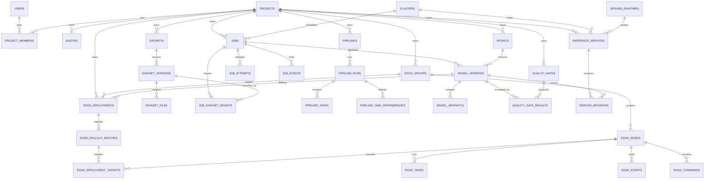

# Blitz 领域模型与数据库设计

| 项目 | 内容 |
|------|------|
| 文档版本 | v0.1 |
| 状态 | 已完成 |
| 适用阶段 | M0 ～ M5 |
| 数据库 | MySQL 8.0+，InnoDB，`utf8mb4_0900_ai_ci` |
| 关联文档 | [README](../README.md)、[architecture.md](architecture.md)、`docs/api.md` |

---

## 目录

- [1. 范围与约定](#1-范围与约定)
- [2. 实体关系与聚合](#2-实体关系与聚合)
- [3. 枚举与状态机](#3-枚举与状态机)
- [4. 表设计](#4-表设计)
- [5. 事务边界与一致性](#5-事务边界与一致性)
- [6. 索引与查询模式](#6-索引与查询模式)
- [7. 分区、归档与保留](#7-分区归档与保留)
- [8. 数据生命周期与安全](#8-数据生命周期与安全)
- [9. 迁移与演进](#9-迁移与演进)
- [10. 待定问题](#10-待定问题)
- [附录 A：核心表 DDL](#附录-a核心表-ddl)

---

## 1. 范围与约定

### 1.1 目标

本文定义 Blitz 的**逻辑领域模型**与 **MySQL 物理模型基线**，覆盖：

- 租户与权限：用户、项目、成员、集群、配额。
- 数据资产：数据集、版本、文件、血缘。
- 训练与流水线：Job、Attempt、事件、日志归档、Pipeline、PipelineRun、Task。
- 模型资产：Model、ModelVersion、Artifact、质量门与评估结果。
- 推理服务：运行时、服务、Revision。
- 边缘协同：分组、节点、标签、发布、批次、目标、任务、事件、命令。
- 平台运维：Outbox、审计、资源快照、幂等键。

不包含：Prometheus/Loki 的时序与日志存储结构、对象存储的桶布局、外部 IdP 的用户主数据。这些在 `docs/operations.md` 与 `docs/edge.md` 中展开。

### 1.2 命名与类型约定

| 项 | 约定 |
|----|------|
| 表名 | 小写复数，`snake_case`，例如 `model_versions` |
| 列名 | 小写 `snake_case`，例如 `model_version_id` |
| 版本列 | 公共乐观锁列固定为 `version`；业务版本号使用 `version_no`，API 对外仍可序列化为 `version` |
| 主键 | `id BIGINT UNSIGNED`，Snowflake 生成 |
| 布尔 | `TINYINT(1)`，0/1 |
| 枚举 | `VARCHAR(32)`，应用层校验；不使用 MySQL `ENUM`，便于演进 |
| 时间 | `DATETIME(3)`，统一 UTC；连接串设置 `time_zone='+00:00'` |
| 金额 | `DECIMAL(18,6)`；本期计费以整数最小单位为主 |
| 资源量 | 整数：CPU 毫核、内存字节、存储字节、GPU 卡数、显存 MiB |
| JSON | MySQL `JSON`；写入前做 JSON Schema 校验 |
| 文本 | 名称 `VARCHAR(128)`，描述 `VARCHAR(1024)`，URI `VARCHAR(1024)` |
| 字符集 | `utf8mb4`，排序规则 `utf8mb4_0900_ai_ci` |
| 存储引擎 | InnoDB，`ROW_FORMAT=DYNAMIC` |

### 1.3 ID 策略

- 使用 **Snowflake** 生成 64 位 ID：41 位毫秒时间 + 10 位 worker + 12 位序列。
- 生成器位于 `pkg/idgen`；worker ID 来自 StatefulSet 序号或环境变量，启动时检测时钟回拨。
- API 将 `id` 序列化为十进制字符串；客户端必须视为不透明标识，不解析时间或顺序。
- K8s label 直接使用十进制字符串；外部资源命名使用 `blitz-{kind}-{id}`，避免与用户资源冲突。
- 不使用 UUID/ULID 作为核心表主键；边缘事件自带的 `event_id` 可以是 UUID/ULID，仅用于去重。

Snowflake 的优点：全局唯一、趋势递增、便于按 `id` 做范围归档与分区；代价是暴露大致创建时间，如需隐藏可在 API 层做 HMAC 映射。

### 1.4 审计列、软删除与乐观锁

业务主表默认包含：

| 列 | 类型 | 说明 |
|----|------|------|
| `id` | `BIGINT UNSIGNED` | 主键，Snowflake |
| `created_at` | `DATETIME(3)` | 创建时间，UTC |
| `updated_at` | `DATETIME(3)` | 更新时间，`ON UPDATE CURRENT_TIMESTAMP(3)` |
| `deleted_at` | `DATETIME(3) NULL` | 软删除时间；NULL 表示未删除 |
| `version` | `BIGINT UNSIGNED` | 乐观锁版本，每次更新 +1 |

**软删除下的唯一名称**：MySQL 唯一索引对多个 NULL 不生效，因此增加生成列：

```sql
is_active TINYINT GENERATED ALWAYS AS (IF(deleted_at IS NULL, 1, NULL)) STORED,
UNIQUE KEY uk_xxx_active_name (project_id, name, is_active)
```

这样同一项目下活跃名称唯一，删除后可复用名称。

**乐观锁**：控制器更新状态时使用：

```sql
UPDATE jobs
SET phase = ?, version = version + 1
WHERE id = ? AND version = ? AND phase = ?;
```

影响行数为 0 表示冲突，重新读取后重新入队。高频心跳、指标类写入不使用 `version`，避免无意义的写冲突。

### 1.5 JSON 与资源计量

- `spec`、`manifest`、`payload`、`inventory`、`labels`、`metrics` 使用 JSON 列。
- 热查询字段必须抽成独立列，不允许在 `WHERE` 中对 JSON 做任意路径查询。
- 单个 JSON 建议不超过 64KB；超过时正文放对象存储，DB 只存 URI 与摘要。
- 资源量统一用整数，禁止浮点数：
  - CPU：毫核（1000 = 1 核）。
  - 内存/存储：字节。
  - GPU：卡数；显存：MiB。
- 资源字符串（如 `A100-80G`）作为字典值存入 `resource` 或 `gpu_type` 列。

### 1.6 外键与引用完整性

- **不建数据库外键**，避免跨表锁、分区限制与迁移耦合。
- 引用完整性由应用层与定期对账任务保证。
- 删除顺序：先标记聚合根 `deleted_at`，控制器清理外部资源；保留期届满后，再按依赖顺序物理删除子表。
- 跨聚合引用只存 ID，不级联更新；通过 Outbox 事件驱动下游。

---

## 2. 实体关系与聚合

### 2.1 实体关系图



`lineage_edges`、`outbox_events`、`audit_logs`、`idempotency_keys` 是跨聚合的横向表，未在 ER 图中展开。

### 2.2 聚合边界

| 聚合 | 聚合根 | 内部实体/值对象 | 一致性边界 |
|------|--------|-----------------|-----------|
| 租户 | Project | ProjectMember、Quota | 项目与成员强一致；配额预留用行锁 |
| 数据集 | Dataset | DatasetVersion、DatasetFile | 版本创建后不可变 |
| 训练 | TrainingJob | JobAttempt、JobEvent、JobDatasetMount | Job 状态与 Attempt 在同一事务更新 |
| 流水线 | PipelineRun | PipelineTask、TaskDependency | Run 与 Task 状态由 Argo 事件驱动 |
| 模型 | Model | ModelVersion、ModelArtifact、QualityGateResult | 发布动作强一致；评估结果可异步补写 |
| 推理 | InferenceService | ServiceRevision | 服务与 Revision 同事务；流量切换最终一致 |
| 边缘发布 | EdgeDeployment | RolloutBatch、DeploymentTarget | 计划生成幂等；目标状态最终一致 |
| 边缘节点 | EdgeNode | NodeLabel、EdgeEvent、EdgeCommand | 心跳弱一致；命令/事件幂等 |
| 边缘任务 | EdgeTask | 无 | 任务状态与结果最终一致 |

跨聚合只通过 ID 引用，不共享事务；需要联动时用 Outbox 事件。

---

## 3. 枚举与状态机

### 3.1 枚举字典

| 枚举 | 取值 | 说明 |
|------|------|------|
| `user_status` | `Active`、`Disabled` | 用户状态 |
| `user_source` | `local`、`oidc`、`ldap` | 用户来源 |
| `project_status` | `Active`、`Archived`、`Deleting` | 项目状态 |
| `member_role` | `Owner`、`Maintainer`、`Developer`、`Viewer` | 项目角色 |
| `quota_policy` | `Hard`、`Soft` | 配额策略 |
| `cluster_status` | `Healthy`、`Degraded`、`Unreachable` | 集群健康 |
| `dataset_status` | `Active`、`Archived` | 数据集状态 |
| `dataset_version_status` | `Creating`、`Validating`、`Ready`、`Failed`、`Deprecated` | 数据集版本 |
| `lineage_relation` | `derived_from`、`trained_on`、`produced`、`deployed_as` | 血缘关系 |
| `mount_mode` | `ro`、`rw` | 数据集挂载模式 |
| `job_type` | `Training`、`Evaluation`、`DataProcessing`、`PipelineTask` | 任务类型 |
| `job_phase` | `Pending`、`Queuing`、`Initializing`、`Running`、`Succeeded`、`Failed`、`Terminating`、`Stopped` | 任务阶段 |
| `priority` | `Low`、`Medium`、`High`、`Urgent`、`Highest` | 优先级 |
| `failure_class` | `Platform`、`Business`、`User`、`Timeout`、`Preempted` | 失败分类 |
| `external_kind` | `VolcanoJob`、`Workflow` | 外部工作负载类型 |
| `log_format` | `text`、`jsonl`、`gzip` | 日志归档格式 |
| `pipeline_status` | `Active`、`Archived` | 流水线模板状态 |
| `pipeline_task_type` | `Job`、`Data`、`Evaluation`、`Approval` | 流水线节点类型 |
| `pipeline_run_phase` | `Pending`、`Running`、`Paused`、`Succeeded`、`Failed`、`Stopped` | 流水线执行 |
| `pipeline_task_phase` | `Pending`、`Running`、`Succeeded`、`Failed`、`Skipped`、`Stopped` | 流水线节点 |
| `model_status` | `Active`、`Archived` | 模型状态 |
| `model_version_status` | `Draft`、`Validating`、`Validated`、`Released`、`Rejected`、`Deprecated` | 模型版本 |
| `model_format` | `onnx`、`torchscript`、`safetensors` | 模型格式 |
| `quality_gate_status` | `Active`、`Archived` | 质量门状态 |
| `quality_result_status` | `Passed`、`Failed`、`Error` | 质量门结果 |
| `quality_subject_type` | `ModelVersion`、`EdgeDeployment` | 质量门评估对象 |
| `serving_runtime_status` | `Active`、`Disabled` | 推理运行时状态 |
| `inference_service_phase` | `Creating`、`Ready`、`Updating`、`Degraded`、`Stopped` | 推理服务 |
| `service_revision_status` | `Creating`、`Active`、`Retiring`、`Retired`、`Failed` | 服务 Revision |
| `edge_group_status` | `Active`、`Archived` | 边缘分组状态 |
| `edge_node_status` | `Registering`、`Online`、`Degraded`、`Offline`、`Decommissioned` | 边缘节点 |
| `edge_arch` | `amd64`、`arm64` | 边缘节点架构 |
| `edge_deployment_phase` | `Pending`、`RollingOut`、`Paused`、`Succeeded`、`RolledBack`、`Failed` | 边缘发布 |
| `edge_deployment_strategy` | `Canary`、`BlueGreen`、`AllAtOnce` | 边缘发布策略 |
| `edge_batch_status` | `Pending`、`Running`、`Paused`、`Succeeded`、`Failed`、`Skipped` | 发布批次 |
| `edge_target_status` | `Pending`、`Downloading`、`Applying`、`Ready`、`Failed`、`RolledBack` | 发布目标 |
| `edge_task_type` | `IncrementalTraining`、`SampleCollection`、`Diagnostic` | 边缘任务 |
| `edge_task_phase` | `Pending`、`Dispatched`、`Running`、`Succeeded`、`Failed`、`Canceled` | 边缘任务状态 |
| `edge_command_type` | `Diagnose`、`RestartRuntime`、`UpgradeAgent` | 边缘命令类型 |
| `edge_command_status` | `Pending`、`Delivered`、`Acked`、`Failed`、`Expired` | 边缘命令 |
| `event_severity` | `Info`、`Warning`、`Critical` | 事件严重级别 |
| `holder_type` | `Job`、`Service`、`EdgeTask` | 配额持有者类型 |
| `resource_unit` | `count`、`millicore`、`byte`、`mib` | 配额资源单位 |
| `quota_reservation_state` | `Reserved`、`Committed`、`Released` | 配额预留 |
| `release_reason` | `Completed`、`Canceled`、`Failed`、`Expired` | 配额释放原因 |
| `actor_type` | `User`、`System`、`Agent` | 审计主体 |
| `audit_result` | `Success`、`Failure` | 审计结果 |

### 3.2 TrainingJob 状态机

| 当前 | 触发 | 守卫条件 | 下一状态 | 副作用 |
|------|------|----------|----------|--------|
| Pending | 提交成功 | 参数合法、项目 `Active`、配额可预留 | Queuing | 预留配额；写 `job_events`、`outbox` |
| Pending | 用户取消 | 无 | Stopped | 释放预留；记录审计 |
| Queuing | Volcano 已分配 | VJ 创建成功、PodGroup 满足 Gang | Initializing | 记录 `scheduled_at` |
| Queuing | 用户停止 | 无 | Terminating | 标记外部资源待清理 |
| Queuing | 排队超时/抢占 | 超过队列等待上限或被高优先级抢占 | Terminating | 记录 `failure_class=Preempted/Timeout` |
| Initializing | 所有角色 Ready | Pod 全部 Ready | Running | 记录 `started_at` |
| Initializing | 平台失败且可重试 | `attempt_count < max_attempts` | Queuing | 新建 Attempt；保留配额 |
| Initializing | 平台失败且重试耗尽 | 镜像/挂载/配置错误 | Failed | 释放配额；`failure_class=Platform` |
| Running | 主进程退出 0 | exit code = 0 | Succeeded | `finished_at`；归档日志；按 outputs 创建 Draft ModelVersion |
| Running | 主进程退出非 0 | exit code ≠ 0 | Failed | `failure_class=Business`；默认不自动重试 |
| Running | 平台故障 | 节点故障/驱逐/网络异常 | Queuing 或 Failed | 可重试则新 Attempt；否则 Failed |
| Running | 用户停止 | 无 | Terminating | 记录操作人与原因 |
| Running | 超时 | `now > started_at + timeout_seconds` | Terminating | `failure_class=Timeout` |
| Terminating | 清理完成 | VJ/Pod/ConfigMap 引用清理完成 | Stopped | 释放配额；`finished_at` |
| Failed | 手动/平台重试 | 未超过 `max_attempts` 且失败可重试 | Queuing | 新建 Attempt；重新预留配额 |
| Succeeded / Stopped | - | - | 终态 | - |

说明：

- `Failed` 是否为终态由 `failure_class` 与 `attempt_count` 决定：业务失败默认终态；平台失败在重试额度内可回到 `Queuing`。
- 一次重试生成一条 `job_attempts`，`attempt_no` 从 1 递增。
- 终态任务按 `ttl_seconds_after_finished` 清理外部资源，DB 记录保留用于审计与计费。

### 3.3 PipelineRun 状态机

| 当前 | 触发 | 守卫条件 | 下一状态 | 副作用 |
|------|------|----------|----------|--------|
| Pending | 创建 Workflow | DAG 校验通过、参数完整 | Running | 写 `argo_namespace/name` |
| Running | 用户暂停 | Workflow 支持 suspend | Paused | 调用 Argo suspend |
| Paused | 用户恢复 | 无 | Running | 调用 Argo resume |
| Running | 全部节点成功 | 所有 Task `Succeeded/Skipped` | Succeeded | 汇总产物；写 outbox |
| Running | 节点失败且重试耗尽 | 至少一个 Task `Failed` | Failed | 记录失败节点 |
| Running / Paused | 用户停止 | 无 | Stopped | 删除/停止 Workflow |
| Failed | 重跑失败节点 | 用户触发 | Running | 只重跑失败节点及下游 |
| Succeeded / Stopped | - | - | 终态 | - |

### 3.4 ModelVersion 状态机

| 当前 | 触发 | 守卫条件 | 下一状态 | 副作用 |
|------|------|----------|----------|--------|
| Draft | 提交校验 | manifest 完整、文件可访问 | Validating | 创建质量门评估任务 |
| Validating | 规则全部通过 | 指标/格式/签名/影子验证通过 | Validated | 写 `quality_gate_results` |
| Validating | 任一规则失败 | 规则失败或评估异常 | Rejected | 记录失败规则与指标 |
| Validated | 发布 | 有发布权限；如需人工审批则已通过 | Released | 更新 `models.latest_version_id`；写 outbox |
| Validated | 人工拒绝 | 无 | Rejected | 记录原因 |
| Released | 新版本发布/人工废弃 | 无 | Deprecated | 写 outbox；通知引用方迁移 |
| Rejected / Deprecated | - | - | 终态 | - |

不变式：`Released`、`Deprecated` 的版本内容不可修改，只允许更新时间戳与状态。

### 3.5 InferenceService 状态机

| 当前 | 触发 | 守卫条件 | 下一状态 | 副作用 |
|------|------|----------|----------|--------|
| Creating | 副本全部就绪 | `replicas_ready == replicas_desired` | Ready | 写 endpoint；更新 Revision `Active` |
| Creating | 超时仍有副本未就绪 | 超过启动超时 | Degraded | 记录事件；告警 |
| Ready | 变更 spec/模型 | 校验通过 | Updating | 创建新 Revision；旧 Revision `Retiring` |
| Updating | 新 Revision 健康 | 健康检查通过、错误率达标 | Ready | 流量切到 100%；旧 Revision `Retired` |
| Updating | 新 Revision 不健康 | 健康检查失败或指标超阈值 | Degraded | 回滚到上一 Revision；告警 |
| Ready | 健康检查持续失败 | 连续 N 次失败 | Degraded | 摘除异常副本；告警 |
| Degraded | 恢复/回滚 | 有可用 Revision | Updating | 重建或切回 |
| 任意 | 用户停止 | 无 | Stopped | 删除 KServe/Deployment；保留 Revision 记录 |
| Stopped | - | - | 终态 | - |

### 3.6 EdgeNode 状态机

| 当前 | 触发 | 守卫条件 | 下一状态 | 副作用 |
|------|------|----------|----------|--------|
| Registering | 首次心跳 | 证书有效、设备指纹匹配 | Online | 写 `registered_at`；发上线事件 |
| Online | 心跳延迟 | 超过 1.5 个心跳周期或健康分低于阈值 | Degraded | 告警；不中断推理 |
| Degraded | 心跳恢复 | 心跳按时、健康分恢复 | Online | 清除告警 |
| Online / Degraded | 心跳丢失 | 超过 3 个心跳周期 | Offline | 标记离线；不自动下发破坏性操作 |
| Offline | 心跳恢复 | 证书仍有效 | Online | 触发期望状态对账 |
| 任意 | 下线设备 | 无活跃发布目标，或强制下线 | Decommissioned | 吊销证书；清理本地发布记录 |
| Decommissioned | - | - | 终态 | - |

说明：状态由**巡检器**根据 `last_heartbeat_at` 计算，心跳写入本身不直接改状态，避免状态抖动与写放大。

### 3.7 EdgeDeployment 状态机

| 当前 | 触发 | 守卫条件 | 下一状态 | 副作用 |
|------|------|----------|----------|--------|
| Pending | 生成发布计划 | 目标节点数 > 0、模型已 Released | RollingOut | 创建批次与目标；写 outbox |
| RollingOut | 用户暂停/门禁挂起 | 无 | Paused | 停止推进批次 |
| Paused | 用户恢复 | 无 | RollingOut | 从当前批次继续 |
| RollingOut | 全部门禁通过 | 所有目标 `Ready`，指标达标 | Succeeded | 记录完成时间；发事件 |
| RollingOut | 门禁失败/人工回滚 | 存在上一可用版本 | RolledBack | 下发上一版本；目标状态回滚 |
| RollingOut | 计划无效/基础设施错误 | 无可用回滚版本或计划损坏 | Failed | 告警；保留现场 |
| Paused | 用户回滚 | 存在上一可用版本 | RolledBack | 下发上一版本 |
| Succeeded / RolledBack / Failed | - | - | 终态 | - |

### 3.8 EdgeTask 状态机

| 当前 | 触发 | 守卫条件 | 下一状态 | 副作用 |
|------|------|----------|----------|--------|
| Pending | 下发到 Agent | 节点 `Online/Degraded`，资源满足 | Dispatched | 期望状态 revision +1 |
| Dispatched | Agent 确认开始 | Agent 已加载任务与数据窗口 | Running | 记录 `started_at` |
| Running | 任务完成 | 产物上传成功、校验和正确 | Succeeded | 写结果；可生成候选模型 |
| Running | 任务失败/超时 | Agent 报错或超过超时 | Failed | 记录原因；不阻塞推理 |
| Pending / Dispatched | 用户取消 | 无 | Canceled | 从期望状态移除 |
| Running | 用户取消 | 尽力而为 | Canceled | 通知 Agent 终止；保留已产出的部分结果 |
| Succeeded / Failed / Canceled | - | - | 终态 | - |

### 3.9 DatasetVersion 状态机

| 当前 | 触发 | 守卫条件 | 下一状态 | 副作用 |
|------|------|----------|----------|--------|
| Creating | manifest 上传完成 | 文件数/大小与声明一致 | Validating | 启动校验任务 |
| Validating | 校验通过 | 摘要、schema、抽样读取均通过 | Ready | 写 `ready_at`；可被任务挂载 |
| Validating | 校验失败 | 摘要不一致/文件缺失/schema 错误 | Failed | 记录失败原因 |
| Ready | 版本废弃 | 无运行中任务引用，或强制废弃 | Deprecated | 写 outbox；保留只读访问 |
| Failed / Deprecated | - | - | 终态 | - |

### 3.10 QuotaReservation 状态机

| 当前 | 触发 | 守卫条件 | 下一状态 | 副作用 |
|------|------|----------|----------|--------|
| Reserved | 任务开始 | Job 进入 `Initializing/Running` | Committed | 记录 `committed_at` |
| Reserved | 预留续期 | holder 仍活跃 | Reserved | 延长 `expires_at`，不改变配额计数 |
| Reserved | 任务取消/失败 | 无 | Released | 归还 `quotas.reserved` |
| Reserved | 预留过期 | holder 已终态/删除，且 `now > expires_at` | Released | 巡检器归还；告警 |
| Committed | 任务终态 | `Succeeded/Failed/Stopped` | Released | 归还 `quotas.reserved` |
| Released | - | - | 终态 | - |

释放必须幂等：以 `state <> 'Released'` 为条件更新，影响行数为 0 直接返回。处于 `Pending/Queuing/Initializing/Running` 的任务，其预留由巡检器定期续期；过期回收只针对孤儿预留，避免长排队任务被误释放。

---

## 4. 表设计

### 4.1 公共列

除特别说明外，业务表包含 §1.4 的公共列。以下字段表只列业务列；`id`、`created_at`、`updated_at`、`deleted_at`、`version` 不再重复。

事件/日志/审计类表只包含 `id`、`created_at`（以及 `received_at`），不软删除、不更新。

### 4.2 平台与租户

#### 4.2.1 `users`

| 字段 | 类型 | 说明 |
|------|------|------|
| `username` | `VARCHAR(64) NOT NULL` | 登录名 |
| `display_name` | `VARCHAR(128)` | 显示名 |
| `email` | `VARCHAR(255)` | 邮箱，可空 |
| `source` | `VARCHAR(16) NOT NULL` | `local` / `oidc` / `ldap` |
| `status` | `VARCHAR(16) NOT NULL` | `Active` / `Disabled` |
| `last_login_at` | `DATETIME(3)` | 最近登录 |
| `profile` | `JSON` | 头像、部门等非关键属性 |

索引：`uk_users_username(username)`、`uk_users_email(email)`（MySQL 允许多个 NULL）。

#### 4.2.2 `projects`

| 字段 | 类型 | 说明 |
|------|------|------|
| `name` | `VARCHAR(64) NOT NULL` | 项目名，全局唯一 |
| `display_name` | `VARCHAR(128)` | 展示名 |
| `namespace` | `VARCHAR(63) NOT NULL` | 云端 K8s Namespace |
| `description` | `VARCHAR(1024)` | 描述 |
| `owner_user_id` | `BIGINT UNSIGNED NOT NULL` | 所有者 |
| `status` | `VARCHAR(16) NOT NULL` | `Active` / `Archived` / `Deleting` |
| `quota_policy` | `VARCHAR(16) NOT NULL` | `Hard` / `Soft` |
| `settings` | `JSON` | 项目级配置 |

索引：`uk_projects_active_name(name, is_active)`、`uk_projects_namespace(namespace)`、`idx_projects_owner(owner_user_id)`。

`namespace` 生成规则：`blitz-p-{id 的 base36}`；创建时先取 ID 再写库，保证全局唯一且可预测。

#### 4.2.3 `project_members`

| 字段 | 类型 | 说明 |
|------|------|------|
| `project_id` | `BIGINT UNSIGNED NOT NULL` | 项目 |
| `user_id` | `BIGINT UNSIGNED NOT NULL` | 用户 |
| `role` | `VARCHAR(16) NOT NULL` | `Owner` / `Maintainer` / `Developer` / `Viewer` |
| `invited_by` | `BIGINT UNSIGNED` | 邀请人 |
| `created_at` | `DATETIME(3) NOT NULL` | 加入时间 |

主键：`(project_id, user_id)`；索引：`idx_project_members_user(user_id)`。

关联表使用复合主键，不设 `id`、`updated_at`、`deleted_at`、`version`，只保留公共列 `created_at`（语义为加入时间）。

#### 4.2.4 `clusters`

| 字段 | 类型 | 说明 |
|------|------|------|
| `name` | `VARCHAR(64) NOT NULL` | 集群名 |
| `region` | `VARCHAR(64)` | 地域 |
| `zone` | `VARCHAR(64)` | 可用区 |
| `api_endpoint` | `VARCHAR(512)` | K8s API 地址 |
| `kubeconfig_secret` | `VARCHAR(255)` | K8s Secret 引用，不存明文 |
| `labels` | `JSON` | 集群标签，如 GPU 型号、网络域 |
| `capacity` | `JSON` | 最近一次容量快照摘要 |
| `status` | `VARCHAR(16) NOT NULL` | `Healthy` / `Degraded` / `Unreachable` |
| `last_heartbeat_at` | `DATETIME(3)` | 最近一次连通性检查 |

索引：`uk_clusters_name(name)`、`idx_clusters_status(status)`。

#### 4.2.5 `quotas`

| 字段 | 类型 | 说明 |
|------|------|------|
| `project_id` | `BIGINT UNSIGNED NOT NULL` | 项目 |
| `resource` | `VARCHAR(64) NOT NULL` | 资源键，如 `gpu:A100-80G`、`cpu_millicores` |
| `unit` | `VARCHAR(16) NOT NULL` | `count` / `millicore` / `byte` / `mib` |
| `hard_limit` | `BIGINT UNSIGNED NOT NULL` | 硬上限 |
| `reserved` | `BIGINT UNSIGNED NOT NULL DEFAULT 0` | 已预留 |
| `used` | `BIGINT UNSIGNED NOT NULL DEFAULT 0` | 最近统计占用，异步刷新 |

索引：`uk_quotas_project_resource(project_id, resource)`。

准入以 `reserved` 为准，`used` 仅用于展示与对账。`reserved` 必须满足 `0 <= reserved <= hard_limit`。

#### 4.2.6 `quota_reservations`

| 字段 | 类型 | 说明 |
|------|------|------|
| `project_id` | `BIGINT UNSIGNED NOT NULL` | 项目 |
| `resource` | `VARCHAR(64) NOT NULL` | 资源键 |
| `amount` | `BIGINT UNSIGNED NOT NULL` | 预留量 |
| `holder_type` | `VARCHAR(16) NOT NULL` | `Job` / `Service` / `EdgeTask` |
| `holder_id` | `BIGINT UNSIGNED NOT NULL` | 持有者 ID |
| `state` | `VARCHAR(16) NOT NULL` | `Reserved` / `Committed` / `Released` |
| `expires_at` | `DATETIME(3) NOT NULL` | 预留过期时间；活跃持有者由巡检器续期 |
| `committed_at` | `DATETIME(3)` | 转为 `Committed` 的时间 |
| `released_at` | `DATETIME(3)` | 释放时间 |
| `release_reason` | `VARCHAR(64)` | `Completed` / `Canceled` / `Failed` / `Expired` |
| `active_flag` | `TINYINT GENERATED ALWAYS AS (IF(state = 'Released', NULL, 1)) STORED` | 活跃预留标记；`Released` 后为 NULL，释放唯一约束 |

索引：`uk_quota_reservations_holder(holder_type, holder_id, resource, active_flag)`、`idx_quota_reservations_expire(project_id, state, expires_at)`。

同一持有者重试时为新的 Attempt 新建预留；`Released` 记录保留，`active_flag = NULL` 不参与唯一约束。

#### 4.2.7 `idempotency_keys`

| 字段 | 类型 | 说明 |
|------|------|------|
| `scope` | `VARCHAR(64) NOT NULL` | 作用域，如 `project:{id}:POST:/jobs` |
| `key_hash` | `CHAR(64) NOT NULL` | 客户端 `Idempotency-Key` 的 SHA-256 |
| `request_hash` | `CHAR(64) NOT NULL` | 请求体 SHA-256 |
| `response_code` | `INT` | 缓存的响应码 |
| `response_body` | `JSON` | 缓存的响应体（截断大字段） |
| `resource_type` | `VARCHAR(32)` | 创建出的资源类型 |
| `resource_id` | `BIGINT UNSIGNED` | 创建出的资源 ID |
| `expires_at` | `DATETIME(3) NOT NULL` | 过期时间 |

索引：`uk_idempotency_scope_key(scope, key_hash)`、`idx_idempotency_expire(expires_at)`。

### 4.3 数据集与血缘

#### 4.3.1 `datasets`

| 字段 | 类型 | 说明 |
|------|------|------|
| `project_id` | `BIGINT UNSIGNED NOT NULL` | 项目 |
| `name` | `VARCHAR(64) NOT NULL` | 数据集名 |
| `display_name` | `VARCHAR(128)` | 展示名 |
| `description` | `VARCHAR(1024)` | 描述 |
| `format` | `VARCHAR(32)` | `parquet` / `coco` / `image-folder` 等 |
| `status` | `VARCHAR(16) NOT NULL` | `Active` / `Archived` |
| `default_version_id` | `BIGINT UNSIGNED` | 默认版本 |
| `labels` | `JSON` | 标签 |

索引：`uk_datasets_active_name(project_id, name, is_active)`、`idx_datasets_project_status(project_id, status)`。

#### 4.3.2 `dataset_versions`

| 字段 | 类型 | 说明 |
|------|------|------|
| `dataset_id` | `BIGINT UNSIGNED NOT NULL` | 数据集 |
| `project_id` | `BIGINT UNSIGNED NOT NULL` | 冗余项目 ID，便于隔离查询 |
| `version_no` | `VARCHAR(64) NOT NULL` | 业务版本号，如 `v12`；与公共乐观锁 `version` 区分 |
| `status` | `VARCHAR(16) NOT NULL` | 见枚举 |
| `uri` | `VARCHAR(1024) NOT NULL` | 数据根 URI，创建时确定 |
| `manifest_uri` | `VARCHAR(1024)` | manifest 位置；进入 `Validating` 前必须非空 |
| `digest` | `CHAR(64)` | manifest 或整体内容摘要；进入 `Validating` 前必须非空 |
| `size_bytes` | `BIGINT UNSIGNED NOT NULL DEFAULT 0` | 总大小 |
| `file_count` | `INT UNSIGNED NOT NULL DEFAULT 0` | 文件数 |
| `schema` | `JSON` | 字段与标注规范 |
| `metadata` | `JSON` | 采样、统计、来源信息 |
| `created_by` | `BIGINT UNSIGNED` | 创建人 |
| `ready_at` | `DATETIME(3)` | 校验通过时间 |
| `deprecated_at` | `DATETIME(3)` | 废弃时间 |

索引：`uk_dataset_versions_no(dataset_id, version_no)`、`idx_dataset_versions_status(dataset_id, status)`、`idx_dataset_versions_digest(digest)`。

不变式：`Creating` 阶段只保证 `uri` 已知；进入 `Validating` 前 `manifest_uri` 与 `digest` 必须非空。`Ready` 之后 `uri`、`digest`、`manifest_uri` 不可修改。

#### 4.3.3 `dataset_files`

| 字段 | 类型 | 说明 |
|------|------|------|
| `dataset_version_id` | `BIGINT UNSIGNED NOT NULL` | 版本 |
| `path` | `VARCHAR(1024) NOT NULL` | 相对路径 |
| `digest` | `CHAR(64) NOT NULL` | 文件 SHA-256 |
| `size_bytes` | `BIGINT UNSIGNED NOT NULL` | 文件大小 |
| `mime_type` | `VARCHAR(128)` | MIME 类型 |

索引：`uk_dataset_files_path(dataset_version_id, path)`、`idx_dataset_files_digest(digest)`。

该表是 manifest 的规范化投影，便于按摘要查重；manifest 仍是权威来源。

#### 4.3.4 `lineage_edges`

| 字段 | 类型 | 说明 |
|------|------|------|
| `project_id` | `BIGINT UNSIGNED NOT NULL` | 项目 |
| `from_type` | `VARCHAR(32) NOT NULL` | 源类型 |
| `from_id` | `BIGINT UNSIGNED NOT NULL` | 源 ID |
| `to_type` | `VARCHAR(32) NOT NULL` | 目标类型 |
| `to_id` | `BIGINT UNSIGNED NOT NULL` | 目标 ID |
| `relation` | `VARCHAR(32) NOT NULL` | `derived_from` / `trained_on` / `produced` / `deployed_as` |
| `metadata` | `JSON` | 额外信息 |

索引：`uk_lineage_edge(project_id, from_type, from_id, to_type, to_id, relation)`、`idx_lineage_to(to_type, to_id)`、`idx_lineage_from(from_type, from_id)`。

#### 4.3.5 `job_dataset_mounts`

| 字段 | 类型 | 说明 |
|------|------|------|
| `job_id` | `BIGINT UNSIGNED NOT NULL` | 任务 |
| `dataset_version_id` | `BIGINT UNSIGNED NOT NULL` | 数据集版本 |
| `mount_path` | `VARCHAR(512) NOT NULL` | 容器内路径 |
| `mode` | `VARCHAR(8) NOT NULL` | `ro` / `rw` |

主键：`(job_id, dataset_version_id, mount_path)`；索引：`idx_job_dataset_version(dataset_version_id)`。

### 4.4 训练与流水线

#### 4.4.1 `jobs`

| 字段 | 类型 | 说明 |
|------|------|------|
| `project_id` | `BIGINT UNSIGNED NOT NULL` | 项目 |
| `cluster_id` | `BIGINT UNSIGNED` | 目标集群，调度后写入 |
| `name` | `VARCHAR(128) NOT NULL` | 任务名 |
| `job_type` | `VARCHAR(32) NOT NULL` | 见枚举 |
| `phase` | `VARCHAR(32) NOT NULL` | 任务阶段 |
| `priority` | `VARCHAR(16) NOT NULL DEFAULT 'Medium'` | 优先级 |
| `queue_name` | `VARCHAR(64) NOT NULL` | Volcano Queue |
| `image` | `VARCHAR(512) NOT NULL` | 训练镜像 |
| `entrypoint` | `JSON` | command / args |
| `env` | `JSON` | 环境变量；敏感值只存 Secret 引用 |
| `roles` | `JSON` | master/worker/ps 等角色与副本数 |
| `resources` | `JSON` | CPU/内存/GPU/显存 |
| `spec` | `JSON NOT NULL` | 完整任务规格快照 |
| `timeout_seconds` | `INT UNSIGNED NOT NULL DEFAULT 0` | 0 表示不超时 |
| `ttl_seconds_after_finished` | `INT UNSIGNED NOT NULL DEFAULT 604800` | 终态保留时间 |
| `max_attempts` | `INT UNSIGNED NOT NULL DEFAULT 1` | 最大尝试次数 |
| `attempt_count` | `INT UNSIGNED NOT NULL DEFAULT 0` | 已尝试次数 |
| `retry_policy` | `JSON` | 退避与可重试失败类型 |
| `scheduled_at` | `DATETIME(3)` | 资源分配时间 |
| `started_at` | `DATETIME(3)` | 开始运行时间 |
| `finished_at` | `DATETIME(3)` | 终态时间 |
| `last_transition_at` | `DATETIME(3) NOT NULL` | 最近状态变化 |
| `failure_class` | `VARCHAR(16)` | 失败分类 |
| `failure_reason` | `VARCHAR(1024)` | 失败原因 |
| `external_kind` | `VARCHAR(32)` | `VolcanoJob` / `Workflow` |
| `external_namespace` | `VARCHAR(63)` | 外部资源命名空间 |
| `external_name` | `VARCHAR(253)` | 外部资源名 |
| `external_ref` | `JSON` | 外部资源完整引用 |
| `spec_version` | `INT UNSIGNED NOT NULL DEFAULT 1` | 规格版本 |
| `legacy_id` | `VARCHAR(64)` | 旧平台任务 ID，迁移用 |
| `created_by` | `BIGINT UNSIGNED` | 创建人 |
| `labels` | `JSON` | 标签 |

索引：

- `uk_jobs_active_name(project_id, name, is_active)`
- `idx_jobs_project_phase(project_id, phase, created_at)`
- `idx_jobs_project_created(project_id, created_at, id)`
- `idx_jobs_cluster_phase(cluster_id, phase)`
- `idx_jobs_queue_phase(queue_name, phase)`
- `idx_jobs_external(external_kind, external_namespace, external_name)`
- `idx_jobs_legacy(legacy_id)`

#### 4.4.2 `job_attempts`

| 字段 | 类型 | 说明 |
|------|------|------|
| `job_id` | `BIGINT UNSIGNED NOT NULL` | 任务 |
| `attempt_no` | `INT UNSIGNED NOT NULL` | 从 1 开始 |
| `phase` | `VARCHAR(32) NOT NULL` | 该次尝试状态 |
| `cluster_id` | `BIGINT UNSIGNED` | 集群 |
| `external_namespace` | `VARCHAR(63)` | 外部资源命名空间 |
| `external_name` | `VARCHAR(253)` | 外部资源名 |
| `started_at` | `DATETIME(3)` | 开始时间 |
| `finished_at` | `DATETIME(3)` | 结束时间 |
| `exit_code` | `INT` | 主进程退出码 |
| `failure_class` | `VARCHAR(16)` | 失败分类 |
| `failure_reason` | `VARCHAR(1024)` | 失败原因 |
| `metrics` | `JSON` | 资源与训练指标摘要 |

索引：`uk_job_attempts_no(job_id, attempt_no)`、`idx_job_attempts_phase(job_id, phase)`。

#### 4.4.3 `job_events`

| 字段 | 类型 | 说明 |
|------|------|------|
| `job_id` | `BIGINT UNSIGNED NOT NULL` | 任务 |
| `attempt_id` | `BIGINT UNSIGNED` | 关联 Attempt，可空 |
| `type` | `VARCHAR(64) NOT NULL` | 事件类型 |
| `reason` | `VARCHAR(128)` | 简短原因 |
| `message` | `VARCHAR(2048)` | 详情 |
| `payload` | `JSON` | 结构化数据 |

索引：`idx_job_events_job(job_id, created_at)`、`idx_job_events_type(type, created_at)`。

append-only；是任务时间线与审计的公共来源。

#### 4.4.4 `job_log_archives`

| 字段 | 类型 | 说明 |
|------|------|------|
| `job_id` | `BIGINT UNSIGNED NOT NULL` | 任务 |
| `attempt_id` | `BIGINT UNSIGNED` | 尝试 |
| `uri` | `VARCHAR(1024) NOT NULL` | 对象存储地址 |
| `size_bytes` | `BIGINT UNSIGNED NOT NULL` | 大小 |
| `format` | `VARCHAR(16) NOT NULL` | `text` / `jsonl` / `gzip` |
| `started_at` | `DATETIME(3)` | 日志开始时间 |
| `finished_at` | `DATETIME(3)` | 日志结束时间 |

索引：`idx_job_log_archives_job(job_id, attempt_id)`。

#### 4.4.5 `pipelines`

| 字段 | 类型 | 说明 |
|------|------|------|
| `project_id` | `BIGINT UNSIGNED NOT NULL` | 项目 |
| `name` | `VARCHAR(128) NOT NULL` | 流水线名 |
| `display_name` | `VARCHAR(128)` | 展示名 |
| `description` | `VARCHAR(1024)` | 描述 |
| `spec` | `JSON NOT NULL` | DAG 模板；模板语义版本放在 `spec.version` |
| `status` | `VARCHAR(16) NOT NULL` | `Active` / `Archived` |
| `created_by` | `BIGINT UNSIGNED` | 创建人 |

索引：`uk_pipelines_active_name(project_id, name, is_active)`、`idx_pipelines_project_status(project_id, status)`。

说明：公共 `version` 只作乐观锁；流水线模板自身的语义版本放在 `spec.version` 中，避免同名冲突。

#### 4.4.6 `pipeline_runs`

| 字段 | 类型 | 说明 |
|------|------|------|
| `pipeline_id` | `BIGINT UNSIGNED NOT NULL` | 流水线 |
| `project_id` | `BIGINT UNSIGNED NOT NULL` | 项目 |
| `name` | `VARCHAR(128) NOT NULL` | 运行名 |
| `phase` | `VARCHAR(32) NOT NULL` | 运行状态 |
| `spec_snapshot` | `JSON NOT NULL` | 创建时的 DAG 快照 |
| `parameters` | `JSON` | 运行参数 |
| `argo_namespace` | `VARCHAR(63)` | Argo 命名空间 |
| `argo_name` | `VARCHAR(253)` | Workflow 名 |
| `started_at` | `DATETIME(3)` | 开始时间 |
| `finished_at` | `DATETIME(3)` | 结束时间 |
| `failure_reason` | `VARCHAR(1024)` | 失败原因 |
| `created_by` | `BIGINT UNSIGNED` | 创建人 |

索引：`uk_pipeline_runs_name(pipeline_id, name)`、`idx_pipeline_runs_phase(pipeline_id, phase, created_at)`、`idx_pipeline_runs_project(project_id, phase)`。

#### 4.4.7 `pipeline_tasks`

| 字段 | 类型 | 说明 |
|------|------|------|
| `run_id` | `BIGINT UNSIGNED NOT NULL` | PipelineRun |
| `task_key` | `VARCHAR(64) NOT NULL` | DAG 内唯一键 |
| `name` | `VARCHAR(128) NOT NULL` | 展示名 |
| `task_type` | `VARCHAR(32) NOT NULL` | `Job` / `Data` / `Evaluation` / `Approval` |
| `phase` | `VARCHAR(32) NOT NULL` | 节点状态 |
| `job_id` | `BIGINT UNSIGNED` | 关联 TrainingJob |
| `spec` | `JSON` | 节点规格 |
| `outputs` | `JSON` | 产物 URI 与摘要 |
| `attempt_no` | `INT UNSIGNED NOT NULL DEFAULT 1` | 节点第几次尝试，从 1 开始 |
| `started_at` | `DATETIME(3)` | 开始时间 |
| `finished_at` | `DATETIME(3)` | 结束时间 |
| `failure_reason` | `VARCHAR(1024)` | 失败原因 |

索引：`uk_pipeline_tasks_key(run_id, task_key)`、`idx_pipeline_tasks_phase(run_id, phase)`、`idx_pipeline_tasks_job(job_id)`。

#### 4.4.8 `pipeline_task_dependencies`

| 字段 | 类型 | 说明 |
|------|------|------|
| `run_id` | `BIGINT UNSIGNED NOT NULL` | PipelineRun |
| `task_key` | `VARCHAR(64) NOT NULL` | 下游节点 |
| `depends_on_key` | `VARCHAR(64) NOT NULL` | 上游节点 |

主键：`(run_id, task_key, depends_on_key)`。

### 4.5 模型与质量门

#### 4.5.1 `models`

| 字段 | 类型 | 说明 |
|------|------|------|
| `project_id` | `BIGINT UNSIGNED NOT NULL` | 项目 |
| `name` | `VARCHAR(128) NOT NULL` | 模型名 |
| `display_name` | `VARCHAR(128)` | 展示名 |
| `description` | `VARCHAR(1024)` | 描述 |
| `task_type` | `VARCHAR(32)` | 检测/分类/生成等 |
| `framework` | `VARCHAR(32)` | PyTorch/ONNX 等 |
| `status` | `VARCHAR(16) NOT NULL` | `Active` / `Archived` |
| `latest_version_id` | `BIGINT UNSIGNED` | 最新发布版本 |
| `labels` | `JSON` | 标签 |

索引：`uk_models_active_name(project_id, name, is_active)`、`idx_models_project_status(project_id, status)`。

#### 4.5.2 `model_versions`

| 字段 | 类型 | 说明 |
|------|------|------|
| `model_id` | `BIGINT UNSIGNED NOT NULL` | 模型 |
| `project_id` | `BIGINT UNSIGNED NOT NULL` | 项目 |
| `version_no` | `VARCHAR(64) NOT NULL` | 业务版本号；与公共乐观锁 `version` 区分 |
| `status` | `VARCHAR(32) NOT NULL` | 见枚举 |
| `format` | `VARCHAR(32) NOT NULL` | `onnx` / `torchscript` / `safetensors` |
| `digest` | `CHAR(64) NOT NULL` | manifest 摘要 |
| `manifest_uri` | `VARCHAR(1024) NOT NULL` | manifest 地址 |
| `manifest` | `JSON NOT NULL` | manifest 快照 |
| `size_bytes` | `BIGINT UNSIGNED NOT NULL DEFAULT 0` | 总大小 |
| `source_job_id` | `BIGINT UNSIGNED` | 产出任务 |
| `source_pipeline_run_id` | `BIGINT UNSIGNED` | 产出流水线 |
| `metrics` | `JSON` | 评估指标 |
| `signature` | `JSON` | 签名算法、keyId、值 |
| `quality_gate_id` | `BIGINT UNSIGNED` | 使用的质量门 |
| `quality_gate_result_id` | `BIGINT UNSIGNED` | 最近一次评估结果 |
| `released_at` | `DATETIME(3)` | 发布时间 |
| `deprecated_at` | `DATETIME(3)` | 废弃时间 |
| `created_by` | `BIGINT UNSIGNED` | 创建人 |

索引：`uk_model_versions_no(model_id, version_no)`、`idx_model_versions_status(model_id, status, created_at)`、`idx_model_versions_digest(digest)`、`idx_model_versions_source_job(source_job_id)`。

不变式：`Released`/`Deprecated` 后 `manifest`、`digest`、`format` 不可修改。

#### 4.5.3 `model_artifacts`

| 字段 | 类型 | 说明 |
|------|------|------|
| `model_version_id` | `BIGINT UNSIGNED NOT NULL` | 模型版本 |
| `path` | `VARCHAR(1024) NOT NULL` | 逻辑路径 |
| `digest` | `CHAR(64) NOT NULL` | 文件 SHA-256 |
| `size_bytes` | `BIGINT UNSIGNED NOT NULL` | 大小 |
| `mime_type` | `VARCHAR(128)` | MIME |
| `storage_uri` | `VARCHAR(1024) NOT NULL` | 物理地址，内容寻址 |

索引：`uk_model_artifacts_path(model_version_id, path)`、`idx_model_artifacts_digest(digest)`。

#### 4.5.4 `quality_gates`

| 字段 | 类型 | 说明 |
|------|------|------|
| `project_id` | `BIGINT UNSIGNED NOT NULL` | 项目 |
| `name` | `VARCHAR(128) NOT NULL` | 质量门名 |
| `spec` | `JSON NOT NULL` | 规则、阈值、影子验证配置 |
| `gate_version` | `INT UNSIGNED NOT NULL DEFAULT 1` | 策略版本 |
| `status` | `VARCHAR(16) NOT NULL` | `Active` / `Archived` |
| `created_by` | `BIGINT UNSIGNED` | 创建人 |

索引：`uk_quality_gates_active_name(project_id, name, is_active)`。

#### 4.5.5 `quality_gate_results`

| 字段 | 类型 | 说明 |
|------|------|------|
| `gate_id` | `BIGINT UNSIGNED NOT NULL` | 质量门 |
| `gate_version` | `INT UNSIGNED NOT NULL` | 评估时的策略版本 |
| `subject_type` | `VARCHAR(32) NOT NULL` | `ModelVersion` / `EdgeDeployment` |
| `subject_id` | `BIGINT UNSIGNED NOT NULL` | 被评估对象 |
| `status` | `VARCHAR(16) NOT NULL` | `Passed` / `Failed` / `Error` |
| `rules` | `JSON` | 每条规则的结果与实际值 |
| `metrics` | `JSON` | 评估指标快照 |
| `message` | `VARCHAR(1024)` | 结论说明 |
| `evaluated_at` | `DATETIME(3) NOT NULL` | 评估时间 |
| `evaluated_by` | `VARCHAR(64)` | 评估器标识 |

索引：`idx_quality_results_subject(subject_type, subject_id, evaluated_at)`、`idx_quality_results_gate(gate_id, evaluated_at)`。

### 4.6 推理服务

#### 4.6.1 `serving_runtimes`

| 字段 | 类型 | 说明 |
|------|------|------|
| `name` | `VARCHAR(64) NOT NULL` | 运行时名，如 `vllm` |
| `engine` | `VARCHAR(64) NOT NULL` | 引擎 |
| `engine_version` | `VARCHAR(32)` | 引擎版本 |
| `image` | `VARCHAR(512)` | 默认镜像 |
| `supported_formats` | `JSON` | 支持的模型格式 |
| `capabilities` | `JSON` | 张量并行、前缀缓存等 |
| `status` | `VARCHAR(16) NOT NULL` | `Active` / `Disabled` |
| `project_id` | `BIGINT UNSIGNED` | 为空表示平台级；非空表示项目自定义 |

索引：`uk_serving_runtimes_name(name)`、`idx_serving_runtimes_status(status)`。

#### 4.6.2 `inference_services`

| 字段 | 类型 | 说明 |
|------|------|------|
| `project_id` | `BIGINT UNSIGNED NOT NULL` | 项目 |
| `cluster_id` | `BIGINT UNSIGNED NOT NULL` | 集群 |
| `name` | `VARCHAR(128) NOT NULL` | 服务名 |
| `model_version_id` | `BIGINT UNSIGNED NOT NULL` | 当前模型版本 |
| `runtime_id` | `BIGINT UNSIGNED NOT NULL` | 运行时 |
| `spec` | `JSON NOT NULL` | 副本、资源、伸缩、流量策略 |
| `phase` | `VARCHAR(32) NOT NULL` | 服务状态 |
| `endpoint` | `VARCHAR(512)` | 访问地址 |
| `replicas_desired` | `INT UNSIGNED NOT NULL DEFAULT 1` | 期望副本 |
| `replicas_ready` | `INT UNSIGNED NOT NULL DEFAULT 0` | 就绪副本 |
| `current_revision_id` | `BIGINT UNSIGNED` | 当前主 Revision |
| `created_by` | `BIGINT UNSIGNED` | 创建人 |

索引：`uk_inference_services_active_name(project_id, name, is_active)`、`idx_inference_services_cluster_phase(cluster_id, phase)`、`idx_inference_services_model(model_version_id)`。

#### 4.6.3 `service_revisions`

| 字段 | 类型 | 说明 |
|------|------|------|
| `service_id` | `BIGINT UNSIGNED NOT NULL` | 服务 |
| `revision_no` | `INT UNSIGNED NOT NULL` | 从 1 递增 |
| `model_version_id` | `BIGINT UNSIGNED NOT NULL` | 模型版本 |
| `runtime_id` | `BIGINT UNSIGNED NOT NULL` | 运行时 |
| `spec` | `JSON NOT NULL` | 该 Revision 的完整规格 |
| `traffic_percent` | `INT UNSIGNED NOT NULL DEFAULT 0` | 流量比例 0～100 |
| `status` | `VARCHAR(16) NOT NULL` | Revision 状态 |
| `kserve_namespace` | `VARCHAR(63)` | KServe 命名空间 |
| `kserve_name` | `VARCHAR(253)` | KServe 资源名 |
| `activated_at` | `DATETIME(3)` | 激活时间 |
| `retired_at` | `DATETIME(3)` | 退役时间 |

索引：`uk_service_revisions_no(service_id, revision_no)`、`idx_service_revisions_status(service_id, status)`。

应用层保证同一服务下 `sum(traffic_percent) = 100`；切换流量使用单独事务更新所有 Revision。

### 4.7 边缘协同

#### 4.7.1 `edge_groups`

| 字段 | 类型 | 说明 |
|------|------|------|
| `project_id` | `BIGINT UNSIGNED NOT NULL` | 项目 |
| `name` | `VARCHAR(128) NOT NULL` | 分组名 |
| `description` | `VARCHAR(1024)` | 描述 |
| `selector` | `JSON` | 标签选择器 |
| `status` | `VARCHAR(16) NOT NULL` | `Active` / `Archived` |
| `created_by` | `BIGINT UNSIGNED` | 创建人 |

索引：`uk_edge_groups_active_name(project_id, name, is_active)`、`idx_edge_groups_project_status(project_id, status)`。

#### 4.7.2 `edge_nodes`

| 字段 | 类型 | 说明 |
|------|------|------|
| `project_id` | `BIGINT UNSIGNED NOT NULL` | 项目 |
| `group_id` | `BIGINT UNSIGNED NOT NULL` | 分组 |
| `name` | `VARCHAR(128) NOT NULL` | 节点名 |
| `device_key` | `VARCHAR(128) NOT NULL` | 硬件指纹，全局唯一 |
| `cert_fingerprint` | `CHAR(64) NOT NULL` | 设备证书指纹，全局唯一 |
| `cert_expires_at` | `DATETIME(3) NOT NULL` | 证书过期时间 |
| `status` | `VARCHAR(16) NOT NULL` | 节点状态 |
| `agent_version` | `VARCHAR(32)` | Agent 版本 |
| `os` | `VARCHAR(32)` | 操作系统 |
| `arch` | `VARCHAR(16)` | `amd64` / `arm64` |
| `inventory` | `JSON` | CPU/内存/GPU/磁盘/运行时 |
| `labels` | `JSON` | 标签快照，便于展示 |
| `last_heartbeat_at` | `DATETIME(3)` | 最近心跳 |
| `last_seen_ip` | `VARCHAR(45)` | 最近 IP |
| `registered_at` | `DATETIME(3)` | 注册时间 |
| `decommissioned_at` | `DATETIME(3)` | 下线时间 |

索引：

- `uk_edge_nodes_device_key(device_key)`
- `uk_edge_nodes_cert(cert_fingerprint)`
- `uk_edge_nodes_active_name(project_id, name, is_active)`
- `idx_edge_nodes_group_status(group_id, status)`
- `idx_edge_nodes_heartbeat(last_heartbeat_at)`
- `idx_edge_nodes_project_status(project_id, status)`

#### 4.7.3 `edge_node_labels`

| 字段 | 类型 | 说明 |
|------|------|------|
| `node_id` | `BIGINT UNSIGNED NOT NULL` | 节点 |
| `key` | `VARCHAR(64) NOT NULL` | 标签键 |
| `value` | `VARCHAR(128) NOT NULL` | 标签值 |

主键：`(node_id, key)`；索引：`idx_edge_node_labels_kv(key, value, node_id)`。

用于按标签选择目标节点；`edge_nodes.labels` JSON 只作展示快照。

#### 4.7.4 `edge_deployments`

| 字段 | 类型 | 说明 |
|------|------|------|
| `project_id` | `BIGINT UNSIGNED NOT NULL` | 项目 |
| `group_id` | `BIGINT UNSIGNED NOT NULL` | 目标分组 |
| `name` | `VARCHAR(128) NOT NULL` | 发布名 |
| `model_version_id` | `BIGINT UNSIGNED NOT NULL` | 目标模型版本 |
| `previous_model_version_id` | `BIGINT UNSIGNED` | 回滚版本 |
| `runtime` | `VARCHAR(64) NOT NULL` | 边缘运行时 |
| `strategy` | `VARCHAR(16) NOT NULL` | `Canary` / `BlueGreen` / `AllAtOnce` |
| `spec` | `JSON NOT NULL` | 批次、门禁、回滚策略 |
| `phase` | `VARCHAR(32) NOT NULL` | 发布状态 |
| `current_batch` | `INT UNSIGNED NOT NULL DEFAULT 0` | 当前批次 |
| `total_batches` | `INT UNSIGNED NOT NULL DEFAULT 0` | 总批次 |
| `quality_gate_id` | `BIGINT UNSIGNED` | 质量门 |
| `started_at` | `DATETIME(3)` | 开始时间 |
| `finished_at` | `DATETIME(3)` | 结束时间 |
| `failure_reason` | `VARCHAR(1024)` | 失败原因 |
| `created_by` | `BIGINT UNSIGNED` | 创建人 |

索引：`uk_edge_deployments_active_name(project_id, name, is_active)`、`idx_edge_deployments_group_phase(group_id, phase, created_at)`、`idx_edge_deployments_model(model_version_id)`。

#### 4.7.5 `edge_rollout_batches`

| 字段 | 类型 | 说明 |
|------|------|------|
| `deployment_id` | `BIGINT UNSIGNED NOT NULL` | 发布 |
| `batch_no` | `INT UNSIGNED NOT NULL` | 批次号 |
| `selector` | `JSON` | 该批次的选择器 |
| `target_count` | `INT UNSIGNED NOT NULL DEFAULT 0` | 目标数 |
| `succeeded_count` | `INT UNSIGNED NOT NULL DEFAULT 0` | 成功数 |
| `failed_count` | `INT UNSIGNED NOT NULL DEFAULT 0` | 失败数 |
| `status` | `VARCHAR(16) NOT NULL` | 批次状态 |
| `gate_result` | `JSON` | 门禁评估结果 |
| `started_at` | `DATETIME(3)` | 开始时间 |
| `finished_at` | `DATETIME(3)` | 结束时间 |

索引：`uk_edge_batches_no(deployment_id, batch_no)`、`idx_edge_batches_status(deployment_id, status)`。

#### 4.7.6 `edge_deployment_targets`

| 字段 | 类型 | 说明 |
|------|------|------|
| `deployment_id` | `BIGINT UNSIGNED NOT NULL` | 发布 |
| `batch_id` | `BIGINT UNSIGNED NOT NULL` | 批次 |
| `node_id` | `BIGINT UNSIGNED NOT NULL` | 节点 |
| `model_version_id` | `BIGINT UNSIGNED NOT NULL` | 该目标的目标版本 |
| `desired_revision` | `BIGINT UNSIGNED NOT NULL` | 期望状态 revision |
| `applied_revision` | `BIGINT UNSIGNED` | Agent 已应用 revision |
| `status` | `VARCHAR(16) NOT NULL` | 目标状态 |
| `last_error` | `VARCHAR(1024)` | 最近错误 |

索引：`uk_edge_targets_deployment_node(deployment_id, node_id)`、`idx_edge_targets_batch(batch_id, status)`、`idx_edge_targets_node(node_id, status)`。

#### 4.7.7 `edge_tasks`

| 字段 | 类型 | 说明 |
|------|------|------|
| `project_id` | `BIGINT UNSIGNED NOT NULL` | 项目 |
| `node_id` | `BIGINT UNSIGNED NOT NULL` | 目标节点 |
| `name` | `VARCHAR(128) NOT NULL` | 任务名 |
| `task_type` | `VARCHAR(32) NOT NULL` | 见枚举 |
| `phase` | `VARCHAR(16) NOT NULL` | 任务状态 |
| `priority` | `VARCHAR(16) NOT NULL DEFAULT 'Medium'` | 优先级 |
| `base_model_version_id` | `BIGINT UNSIGNED` | 基础模型 |
| `spec` | `JSON NOT NULL` | 数据窗口、超参、资源上限 |
| `resources` | `JSON` | 资源请求 |
| `data_window` | `JSON` | 时间窗、采样上限 |
| `result` | `JSON` | 指标、产物摘要 |
| `result_model_version_id` | `BIGINT UNSIGNED` | 产出的候选模型版本 |
| `started_at` | `DATETIME(3)` | 开始时间 |
| `finished_at` | `DATETIME(3)` | 结束时间 |
| `failure_reason` | `VARCHAR(1024)` | 失败原因 |
| `created_by` | `BIGINT UNSIGNED` | 创建人 |

索引：`uk_edge_tasks_active_name(project_id, name, is_active)`、`idx_edge_tasks_node_phase(node_id, phase)`、`idx_edge_tasks_project_phase(project_id, phase)`。

#### 4.7.8 `edge_events`

| 字段 | 类型 | 说明 |
|------|------|------|
| `node_id` | `BIGINT UNSIGNED NOT NULL` | 节点 |
| `event_id` | `VARCHAR(64) NOT NULL` | Agent 生成的事件 ID |
| `type` | `VARCHAR(64) NOT NULL` | 事件类型 |
| `severity` | `VARCHAR(16) NOT NULL` | `Info` / `Warning` / `Critical` |
| `payload` | `JSON` | 事件内容 |
| `occurred_at` | `DATETIME(3)` | Agent 本地时间 |
| `received_at` | `DATETIME(3) NOT NULL` | 云端接收时间 |
| `clock_skew_ms` | `INT` | 本地时间与云端时间偏差 |

索引：`uk_edge_events_node_event(node_id, event_id)`、`idx_edge_events_node_time(node_id, received_at)`、`idx_edge_events_type(type, received_at)`。

去重依赖 `(node_id, event_id)`；`received_at` 是排序与归档依据，`occurred_at` 仅作参考。

#### 4.7.9 `edge_commands`

| 字段 | 类型 | 说明 |
|------|------|------|
| `node_id` | `BIGINT UNSIGNED NOT NULL` | 节点 |
| `command_id` | `VARCHAR(64) NOT NULL` | 命令 ID |
| `type` | `VARCHAR(32) NOT NULL` | `Diagnose` / `RestartRuntime` / `UpgradeAgent` |
| `payload` | `JSON` | 命令参数 |
| `status` | `VARCHAR(16) NOT NULL` | 命令状态 |
| `expires_at` | `DATETIME(3) NOT NULL` | 过期时间 |
| `delivered_at` | `DATETIME(3)` | 投递时间 |
| `acked_at` | `DATETIME(3)` | 确认时间 |
| `result` | `JSON` | 执行结果 |

索引：`uk_edge_commands_node_command(node_id, command_id)`、`idx_edge_commands_pending(node_id, status, expires_at)`。

### 4.8 事件、审计与运维

#### 4.8.1 `outbox_events`

| 字段 | 类型 | 说明 |
|------|------|------|
| `aggregate_type` | `VARCHAR(64) NOT NULL` | 聚合类型 |
| `aggregate_id` | `BIGINT UNSIGNED NOT NULL` | 聚合 ID |
| `event_type` | `VARCHAR(96) NOT NULL` | 事件类型 |
| `payload` | `JSON NOT NULL` | 事件体 |
| `headers` | `JSON` | traceId、projectId 等 |
| `attempts` | `INT UNSIGNED NOT NULL DEFAULT 0` | 投递次数 |
| `last_error` | `VARCHAR(1024)` | 最近错误 |
| `published_at` | `DATETIME(3)` | 发布时间；NULL 表示待发布 |

索引：`idx_outbox_pending(published_at, id)`、`idx_outbox_aggregate(aggregate_type, aggregate_id)`。

`id` 即事件 ID（`eventId`），对外序列化为字符串；消费者按 `(consumer, eventId)` 去重，不需要额外生成 UUID。

#### 4.8.2 `audit_logs`

| 字段 | 类型 | 说明 |
|------|------|------|
| `project_id` | `BIGINT UNSIGNED` | 项目，平台级操作可空 |
| `actor_type` | `VARCHAR(16) NOT NULL` | `User` / `System` / `Agent` |
| `actor_id` | `VARCHAR(64)` | 用户 ID、系统组件名或设备 ID |
| `action` | `VARCHAR(64) NOT NULL` | 操作 |
| `object_type` | `VARCHAR(32) NOT NULL` | 对象类型 |
| `object_id` | `BIGINT UNSIGNED` | 对象 ID |
| `before` | `JSON` | 变更前快照 |
| `after` | `JSON` | 变更后快照 |
| `request_id` | `VARCHAR(64)` | 请求 ID |
| `ip` | `VARCHAR(45)` | 客户端 IP |
| `user_agent` | `VARCHAR(512)` | User-Agent |
| `result` | `VARCHAR(16) NOT NULL` | `Success` / `Failure` |
| `message` | `VARCHAR(1024)` | 结果说明 |

索引：`idx_audit_project_time(project_id, created_at)`、`idx_audit_object(object_type, object_id, created_at)`、`idx_audit_actor(actor_id, created_at)`。

append-only；敏感字段在写入前脱敏。

#### 4.8.3 `resource_snapshots`

| 字段 | 类型 | 说明 |
|------|------|------|
| `cluster_id` | `BIGINT UNSIGNED NOT NULL` | 集群 |
| `gpu_type` | `VARCHAR(64) NOT NULL` | GPU 型号；`cpu`/`memory` 也走该表 |
| `total` | `BIGINT UNSIGNED NOT NULL` | 总量 |
| `allocated` | `BIGINT UNSIGNED NOT NULL` | 已分配 |
| `available` | `BIGINT UNSIGNED NOT NULL` | 可用 |
| `details` | `JSON` | 分节点/分队列明细 |
| `updated_at` | `DATETIME(3) NOT NULL` | 采集时间 |

索引：`uk_resource_snapshots(cluster_id, gpu_type)`、`idx_resource_snapshots_updated(updated_at)`。

### 4.9 表清单汇总

| 域 | 表 | 保留策略 |
|----|----|----------|
| 平台 | `users`、`projects`、`project_members`、`clusters`、`quotas`、`quota_reservations`、`idempotency_keys` | 长期；幂等键 24h |
| 数据 | `datasets`、`dataset_versions`、`dataset_files`、`lineage_edges`、`job_dataset_mounts` | 版本长期；文件随对象存储 |
| 训练 | `jobs`、`job_attempts`、`job_events`、`job_log_archives` | Job 180 天热；事件 90 天 |
| 流水线 | `pipelines`、`pipeline_runs`、`pipeline_tasks`、`pipeline_task_dependencies` | Run 180 天热 |
| 模型 | `models`、`model_versions`、`model_artifacts`、`quality_gates`、`quality_gate_results` | 版本长期；评估 1 年 |
| 推理 | `serving_runtimes`、`inference_services`、`service_revisions` | 服务长期；Revision 1 年 |
| 边缘 | `edge_groups`、`edge_nodes`、`edge_node_labels`、`edge_deployments`、`edge_rollout_batches`、`edge_deployment_targets`、`edge_tasks`、`edge_events`、`edge_commands` | 发布 1 年；事件 30 天 |
| 运维 | `outbox_events`、`audit_logs`、`resource_snapshots` | Outbox 7 天；审计 2 年；快照仅最新 |

---

## 5. 事务边界与一致性

### 5.1 隔离级别与事务原则

- 建议使用 `READ COMMITTED`，减少间隙锁与死锁；需要强一致时显式 `SELECT ... FOR UPDATE`。
- 单个事务尽量控制在 100ms 内、1000 行以内；批量操作分片提交。
- 外部资源创建不放在数据库事务中：先幂等创建，再 CAS 更新 DB；失败由下一次 reconcile 补偿。
- 所有状态变更与 Outbox 写入在同一事务，保证「状态变化必有事件」。
- 事件消费至少一次，消费者按 `eventId` 去重。

### 5.2 创建训练任务

```sql
BEGIN;

-- 1. 幂等键：唯一索引冲突时读取已有记录
INSERT INTO idempotency_keys
  (scope, key_hash, request_hash, expires_at, created_at)
VALUES (?, ?, ?, DATE_ADD(NOW(3), INTERVAL 24 HOUR), NOW(3));

-- 若冲突且 request_hash 相同：返回缓存响应
-- 若冲突且 request_hash 不同：返回 409

-- 2. 配额：锁住相关配额行，校验并预留
SELECT resource, hard_limit, reserved
FROM quotas
WHERE project_id = ? AND resource IN (...)
FOR UPDATE;

UPDATE quotas
SET reserved = reserved + ?
WHERE project_id = ? AND resource = ?;

INSERT INTO quota_reservations
  (project_id, resource, amount, holder_type, holder_id, state, expires_at)
VALUES (?, ?, ?, 'Job', ?, 'Reserved', DATE_ADD(NOW(3), INTERVAL 30 MINUTE));

-- 3. 业务写入
INSERT INTO jobs (...);
INSERT INTO job_dataset_mounts (...);
INSERT INTO job_events (job_id, type, reason, message, created_at)
VALUES (?, 'Created', 'Submitted', ?, NOW(3));
INSERT INTO outbox_events
  (aggregate_type, aggregate_id, event_type, payload, created_at)
VALUES ('Job', ?, 'job.created', ?, NOW(3));

-- 4. 回填幂等响应
UPDATE idempotency_keys
SET response_code = 202, response_body = ?, resource_type = 'Job', resource_id = ?
WHERE scope = ? AND key_hash = ?;

COMMIT;
```

要点：

- 配额行按固定顺序加锁（如 `resource` 字典序），避免死锁。
- 预留初设 30 分钟有效期；只要 Job 仍处于活跃状态，巡检器就续期，只有孤儿预留允许过期释放。
- 幂等键先插入，若后续事务失败则整体回滚，不会留下脏键。
- 乐观锁不适用于创建；创建靠唯一键与幂等键。

### 5.3 控制器状态迁移

外部资源创建与 DB 更新分离：

```text
1. 从 Informer/DB 读取 Job
2. 幂等创建 VolcanoJob（AlreadyExists 则读取已有对象）
3. 根据外部状态计算目标 phase
4. CAS 更新 DB（事务内写 job_events、outbox；新建 Attempt 时同时写 job_attempts）
5. 失败则重新入队，由下一次 reconcile 补偿
```

事务示例：

```sql
BEGIN;

SELECT phase, version, attempt_count
FROM jobs
WHERE id = ?
FOR UPDATE;

-- 应用层校验合法迁移
UPDATE jobs
SET phase = ?, version = version + 1, last_transition_at = NOW(3)
WHERE id = ? AND version = ? AND phase = ?;

-- 仅首次入队、重试等需要新 Attempt 的迁移执行；普通状态迁移复用当前 Attempt，不新建记录
INSERT INTO job_attempts
  (job_id, attempt_no, phase, cluster_id, external_namespace, external_name, started_at)
VALUES (?, ?, ?, ?, ?, ?, NOW(3));

INSERT INTO job_events (job_id, attempt_id, type, reason, message, created_at)
VALUES (?, ?, ?, ?, ?, NOW(3));

INSERT INTO outbox_events (aggregate_type, aggregate_id, event_type, payload, created_at)
VALUES ('Job', ?, 'job.phase.changed', ?, NOW(3));

COMMIT;
```

若 CAS 影响行数为 0：回滚并重新入队，不覆盖他人更新。新建 Attempt 时，`jobs.attempt_count` 与 `job_attempts.attempt_no` 在同一事务内递增；其余迁移只更新现有 Attempt 的 phase、时间与失败信息。

### 5.4 模型发布

```sql
BEGIN;

SELECT status, quality_gate_result_id
FROM model_versions
WHERE id = ?
FOR UPDATE;

-- 守卫：status = 'Validated'
-- 守卫：质量门结果 = 'Passed'
-- 守卫：签名校验通过

UPDATE model_versions
SET status = 'Released', released_at = NOW(3), version = version + 1
WHERE id = ? AND status = 'Validated';

UPDATE models
SET latest_version_id = ?, version = version + 1
WHERE id = ?;

INSERT INTO quality_gate_results (...); -- 如尚未写入
INSERT INTO outbox_events (... 'model.released' ...);

COMMIT;
```

发布后禁止修改 manifest；如需修正，创建新版本。`models.latest_version_id` 只是展示指针，更新时必须比较 `released_at`，只允许前进，避免并发发布时回退。

### 5.5 边缘发布计划生成

计划生成可能涉及大量节点，分片处理，唯一键保证幂等：

```sql
BEGIN;

SELECT phase, version
FROM edge_deployments
WHERE id = ?
FOR UPDATE;

-- 第一阶段：按批次插入
INSERT INTO edge_rollout_batches
  (deployment_id, batch_no, selector, target_count, status, created_at)
VALUES (?, ?, ?, ?, 'Pending', NOW(3))
ON DUPLICATE KEY UPDATE selector = VALUES(selector);

INSERT INTO edge_deployment_targets
  (deployment_id, batch_id, node_id, model_version_id, desired_revision, status, created_at)
VALUES (?, ?, ?, ?, ?, 'Pending', NOW(3))
ON DUPLICATE KEY UPDATE model_version_id = VALUES(model_version_id);

-- 全部批次写完后
UPDATE edge_deployments
SET phase = 'RollingOut', total_batches = ?, version = version + 1
WHERE id = ? AND phase = 'Pending';

INSERT INTO outbox_events (... 'edge.deployment.started' ...);

COMMIT;
```

说明：

- 大批量目标按 500～1000 行分片提交；`Pending` 阶段可安全重入。
- 所有目标写入完成后才切 `RollingOut`；中途崩溃由 reconcile 补齐。
- `desired_revision` 由边缘控制器单调递增分配，不能由 Agent 生成。

### 5.6 心跳与事件上报

**心跳**是高频写，避免事务膨胀：

```sql
-- 短事务，不写 outbox，不更新 version
UPDATE edge_nodes
SET last_heartbeat_at = NOW(3),
    inventory = ?,
    agent_version = ?,
    last_seen_ip = ?
WHERE id = ?;
```

节点 `Online/Degraded/Offline` 状态由巡检器统一计算：

```sql
-- 离线巡检
UPDATE edge_nodes
SET status = 'Offline', version = version + 1
WHERE status IN ('Online', 'Degraded')
  AND last_heartbeat_at < DATE_SUB(NOW(3), INTERVAL 90 SECOND);
```

状态实际变化时，由巡检器写 `edge_events` 与 `outbox`。批量巡检先选出候选 ID，再逐节点按 `status` 条件更新；只有影响行数为 1 的节点才写事件，避免重复告警。

**事件批量上报**：

```sql
INSERT INTO edge_events
  (node_id, event_id, type, severity, payload, occurred_at, received_at, clock_skew_ms)
VALUES (?, ?, ?, ?, ?, ?, NOW(3), ?)
ON DUPLICATE KEY UPDATE edge_events.event_id = edge_events.event_id;
```

`ON DUPLICATE KEY UPDATE` 不改变数据，影响行数用于判断是否首次插入；仅首次插入且 `severity` 为 `Warning/Critical` 时写 outbox。

### 5.7 配额释放

```sql
BEGIN;

SELECT amount, state
FROM quota_reservations
WHERE holder_type = ? AND holder_id = ? AND resource = ?
FOR UPDATE;

-- 若 state = 'Released'，直接 COMMIT 返回（幂等）

UPDATE quota_reservations
SET state = 'Released', released_at = NOW(3), release_reason = ?
WHERE id = ? AND state <> 'Released';

UPDATE quotas
SET reserved = GREATEST(reserved - ?, 0), version = version + 1
WHERE project_id = ? AND resource = ?;

COMMIT;
```

巡检器定期清理过期预留：

```sql
SELECT id FROM quota_reservations
WHERE state = 'Reserved' AND expires_at < NOW(3)
LIMIT 100
FOR UPDATE SKIP LOCKED;
```

逐条按上述逻辑释放，避免长事务。释放前必须回查 holder 状态：只有 holder 已进入终态、已被删除，或连续多个续期周期没有心跳的孤儿预留才允许过期释放；活跃 holder 由续期任务延长 `expires_at`。

### 5.8 删除与 Finalizer

1. API 将聚合根 `deleted_at` 置为非空，拒绝新的变更操作。
2. 控制器按依赖顺序清理外部资源：
   - 推理服务：删除 KServe/Deployment、Service、HPA。
   - 流水线：停止并删除 Argo Workflow。
   - 训练任务：停止并删除 VolcanoJob、Pod、ConfigMap。
   - 边缘发布：从期望状态移除目标，等待 Agent 确认或超时。
   - 边缘节点：吊销证书，清理发布目标与命令。
3. 外部资源清理完成后，保留期（默认 30 天）届满再由清理任务按依赖顺序物理删除子表与主表；审计与计费记录按各自保留策略独立保留。
4. 对象存储内容由独立 GC 任务按引用计数与保留期清理。

删除操作写审计日志；批量删除需要二次确认与权限校验。

### 5.9 幂等与并发

| 场景 | 机制 |
|------|------|
| 创建资源 | `Idempotency-Key` + `idempotency_keys` 唯一索引 |
| 重复 reconcile | 外部资源 `AlreadyExists` 视为成功；DB CAS |
| 状态更新 | `WHERE id=? AND version=? AND phase=?` |
| 边缘事件 | `(node_id, event_id)` 唯一 |
| 边缘命令 | `(node_id, command_id)` 唯一 |
| 配额释放 | `state <> 'Released'` 条件更新 |
| 发布计划 | `(deployment_id, node_id)` 唯一，`ON DUPLICATE KEY` |
| Outbox | `FOR UPDATE SKIP LOCKED` + 消费者按 `outbox_events.id`（`eventId`）去重 |

---

## 6. 索引与查询模式

| 查询 | 索引 | 说明 |
|------|------|------|
| 项目下任务列表 | `idx_jobs_project_created(project_id, created_at, id)` | 键集分页，避免 OFFSET |
| 项目下按阶段筛选 | `idx_jobs_project_phase(project_id, phase, created_at)` | 状态页 |
| 集群内排队任务 | `idx_jobs_cluster_phase(cluster_id, phase)` | 调度视图 |
| 队列内任务 | `idx_jobs_queue_phase(queue_name, phase)` | 队列视图 |
| 任务 Attempt | `uk_job_attempts_no(job_id, attempt_no)` | 时间线 |
| 任务事件 | `idx_job_events_job(job_id, created_at)` | 日志与排障 |
| 模型版本列表 | `idx_model_versions_status(model_id, status, created_at)` | 版本页 |
| 按摘要找模型 | `idx_model_versions_digest(digest)` | 去重与复用 |
| 服务列表 | `idx_inference_services_cluster_phase(cluster_id, phase)` | 集群视图 |
| 服务 Revision | `uk_service_revisions_no(service_id, revision_no)` | 发布历史 |
| 边缘节点列表 | `idx_edge_nodes_group_status(group_id, status)` | 分组视图 |
| 离线巡检 | `idx_edge_nodes_heartbeat(last_heartbeat_at)` | 巡检器 |
| 标签选节点 | `idx_edge_node_labels_kv(key, value, node_id)` | 选择器 |
| 发布目标 | `idx_edge_targets_batch(batch_id, status)` | 批次推进 |
| 节点上的发布 | `idx_edge_targets_node(node_id, status)` | Agent 对账 |
| 边缘事件 | `idx_edge_events_node_time(node_id, received_at)` | 排障 |
| 待发布 Outbox | `idx_outbox_pending(published_at, id)` | Relay |
| 审计查询 | `idx_audit_project_time(project_id, created_at)` | 合规检索 |

查询约束：

- 列表默认按 `created_at DESC, id DESC` 排序，使用键集分页。
- 禁止在热路径使用 `%keyword%` 模糊搜索；如需搜索接入 OpenSearch/Doris。
- 禁止在 `WHERE` 中对 JSON 做函数计算；需要筛选的字段抽列。
- 统计类查询走汇总表或 OLAP，不在主库做全表聚合。

---

## 7. 分区、归档与保留

### 7.1 一期：归档表优先

一期不启用 MySQL 原生分区，原因是业务唯一键（如 `(project_id, name)`）与分区键存在约束冲突。采用「热表 + 归档表」：

| 表 | 热表保留 | 归档表 | 归档依据 |
|----|----------|--------|----------|
| `jobs` | 终态后 180 天 | `jobs_archive` | `finished_at` |
| `job_events` | 90 天 | `job_events_archive` | `created_at` |
| `edge_events` | 30 天 | `edge_events_archive` | `received_at` |
| `audit_logs` | 2 年 | `audit_logs_archive` | `created_at` |
| `outbox_events` | 发布后 7 天 | 直接删除 | `published_at` |

归档任务：

1. 按主键范围读取一批（如 1000 行），写入归档表。
2. 校验行数与摘要。
3. 按主键删除热表数据。
4. 记录水位，失败可重试；禁止跨批长事务。

### 7.2 二期：原生分区

当单表超过约 5000 万行且归档仍无法满足查询性能时，按表选择分区方式：

| 表 | 分区方式 | 说明 |
|----|----------|------|
| `job_events` | `RANGE(id)` 按月 | 只有主键，无业务唯一键，可直接分区 |
| `audit_logs` | `RANGE(id)` 按月 | 同上 |
| `outbox_events` | `RANGE(id)` 按月 | 只保留近期数据 |
| `jobs` | `HASH(project_id)` 32 分区 | 主键改为 `(id, project_id)`；唯一键包含 `project_id` |
| `edge_events` | `HASH(node_id)` 32 分区 | 主键改为 `(node_id, id)`；唯一键包含 `node_id` |

注意事项：

- MySQL 要求分区键出现在每个唯一键中；切换前必须调整主键与唯一键。
- 分区维护任务提前创建未来 3 个月分区，归档后 `DROP PARTITION`。
- 分区表上的 `ALTER TABLE` 成本更高，DDL 需在低峰期执行。

### 7.3 保留与合规

- 计费明细保留 2 年；汇总长期保留。
- 审计日志默认 2 年，合规要求可延长至 7 年。
- 边缘原始样本默认 30 天，标注后数据集按项目策略保留。
- 软删除数据保留 30 天后物理清理；对象存储按引用计数延迟清理。

---

## 8. 数据生命周期与安全

### 8.1 数据分类

| 类别 | 示例 | 存储 | 保护 |
|------|------|------|------|
| 平台元数据 | 项目、任务、模型版本 | MySQL | 项目隔离、RBAC |
| 数据集内容 | 图像、文本、标注 | 对象存储 | 桶策略、签名 URL、加密 |
| 边缘样本 | 难例、现场图像 | 对象存储/边缘磁盘 | 默认不出域、加密、最小权限 |
| 日志 | 训练日志、Agent 日志 | 对象存储/Loki | 脱敏、访问审计 |
| 密钥 | kubeconfig、证书私钥、模型签名私钥 | K8s Secret/KMS | 不落 DB、不落日志 |

### 8.2 访问控制

- 数据库账号按服务拆分：`blitz_api`、`blitz_controller`、`blitz_migrate`、只读分析账号。
- 所有租户表查询必须带 `project_id`；DAO 层统一注入，禁止裸写 SQL 绕过。
- 对象存储使用预签名 URL，有效期不超过 15 分钟；边缘上传使用一次性 URL。
- 审计日志不可修改；高权限操作双人复核（二期）。

### 8.3 删除与导出

- 项目删除：停止任务、撤销边缘证书、标记所有聚合根、保留审计与计费记录。
- 用户数据导出：按项目导出元数据与对象清单，不包含他人数据。
- 模型与数据集删除前检查引用：被服务或发布引用时拒绝，除非强制并记录审计。
- 备份：MySQL 每日全量 + binlog PITR；对象存储版本化；每季度恢复演练。

---

## 9. 迁移与演进

### 9.1 Schema 迁移

- 使用 `schema_migrations(version, dirty, applied_at)` 记录版本；迁移脚本只向前。
- 采用 expand-contract：
  1. 新增列/表（可空、带默认值）。
  2. 双写或后台回填。
  3. 切换读路径。
  4. 删除旧列/旧表（至少一个大版本之后）。
- 枚举只增不减；删除枚举值前先迁移数据。
- 大表 DDL 使用在线工具（gh-ost/pt-osc）或低峰窗口。

### 9.2 从 workload_manager 迁移

| 旧数据 | 新表 | 映射 |
|--------|------|------|
| Job | `jobs` | `legacy_id` 保存旧 ID；`Queued` → `Queuing`；`Stopped` 保持 |
| Job 重试轮次 | `job_attempts` | `retry_round` → `attempt_no + 1` |
| DAG | `pipelines` / `pipeline_runs` | 模板与运行分离 |
| DAG 节点 | `pipeline_tasks` | 保留 task key 与依赖 |
| 计费事件 | `outbox_events` → Kafka `billing.events` | 保留事件 ID 去重；由计费系统落账，Outbox 不是长期账本 |

迁移工具要求：

- 可重复执行；以 `legacy_id` 幂等。
- 先迁元数据，再迁对象存储引用。
- 迁移前后做行数与摘要校验。
- 保留只读回退开关，验证一个版本后再关闭旧写路径。

### 9.3 版本兼容

- API 版本 `/api/v1` 内保持向后兼容；破坏性变更开 `/api/v2`。
- DB 字段只增不删；JSON 字段通过 `schemaVersion` 演进。
- 新控制器必须能处理旧数据；旧控制器不要求理解新字段。

---

## 10. 待定问题

1. `id` 是否需要对外做不可逆映射，避免暴露创建时间与规模？
2. `jobs` 何时切换到原生分区？是否接受主键改为 `(id, project_id)`？
3. 高并发下是否引入 Redis 预扣来降低 MySQL 行锁竞争？MySQL 仍是事实来源，Redis 只做准入缓冲。
4. `edge_events` 的去重窗口保留多久？是否需要跨月唯一？
5. 模型 manifest 是否需要拆表规范化，还是保持 JSON + 关键列？
6. 审计日志的合规要求是否超过 2 年？是否需要 WORM 存储？
7. 多地域部署时，MySQL 采用单主多从还是每地域独立写入？
8. 边缘样本的对象存储是否与云端训练数据物理隔离？

---

## 附录 A：核心表 DDL

以下 DDL 仅示意字段、索引与约束，实际以迁移脚本为准。公共列已展开。

### A.1 `jobs`

```sql
CREATE TABLE jobs (
  id BIGINT UNSIGNED NOT NULL,
  project_id BIGINT UNSIGNED NOT NULL,
  cluster_id BIGINT UNSIGNED NULL,
  name VARCHAR(128) NOT NULL,
  job_type VARCHAR(32) NOT NULL,
  phase VARCHAR(32) NOT NULL,
  priority VARCHAR(16) NOT NULL DEFAULT 'Medium',
  queue_name VARCHAR(64) NOT NULL,
  image VARCHAR(512) NOT NULL,
  entrypoint JSON NULL,
  env JSON NULL,
  roles JSON NULL,
  resources JSON NULL,
  spec JSON NOT NULL,
  timeout_seconds INT UNSIGNED NOT NULL DEFAULT 0,
  ttl_seconds_after_finished INT UNSIGNED NOT NULL DEFAULT 604800,
  max_attempts INT UNSIGNED NOT NULL DEFAULT 1,
  attempt_count INT UNSIGNED NOT NULL DEFAULT 0,
  retry_policy JSON NULL,
  scheduled_at DATETIME(3) NULL,
  started_at DATETIME(3) NULL,
  finished_at DATETIME(3) NULL,
  last_transition_at DATETIME(3) NOT NULL DEFAULT CURRENT_TIMESTAMP(3),
  failure_class VARCHAR(16) NULL,
  failure_reason VARCHAR(1024) NULL,
  external_kind VARCHAR(32) NULL,
  external_namespace VARCHAR(63) NULL,
  external_name VARCHAR(253) NULL,
  external_ref JSON NULL,
  spec_version INT UNSIGNED NOT NULL DEFAULT 1,
  legacy_id VARCHAR(64) NULL,
  created_by BIGINT UNSIGNED NULL,
  labels JSON NULL,
  created_at DATETIME(3) NOT NULL DEFAULT CURRENT_TIMESTAMP(3),
  updated_at DATETIME(3) NOT NULL DEFAULT CURRENT_TIMESTAMP(3)
    ON UPDATE CURRENT_TIMESTAMP(3),
  deleted_at DATETIME(3) NULL,
  version BIGINT UNSIGNED NOT NULL DEFAULT 1,
  is_active TINYINT GENERATED ALWAYS AS (IF(deleted_at IS NULL, 1, NULL)) STORED,
  PRIMARY KEY (id),
  UNIQUE KEY uk_jobs_active_name (project_id, name, is_active),
  KEY idx_jobs_project_phase (project_id, phase, created_at),
  KEY idx_jobs_project_created (project_id, created_at, id),
  KEY idx_jobs_cluster_phase (cluster_id, phase),
  KEY idx_jobs_queue_phase (queue_name, phase),
  KEY idx_jobs_external (external_kind, external_namespace, external_name),
  KEY idx_jobs_legacy (legacy_id)
) ENGINE=InnoDB DEFAULT CHARSET=utf8mb4 COLLATE=utf8mb4_0900_ai_ci
  ROW_FORMAT=DYNAMIC;
```

### A.2 `model_versions`

```sql
CREATE TABLE model_versions (
  id BIGINT UNSIGNED NOT NULL,
  model_id BIGINT UNSIGNED NOT NULL,
  project_id BIGINT UNSIGNED NOT NULL,
  version_no VARCHAR(64) NOT NULL,
  status VARCHAR(32) NOT NULL,
  format VARCHAR(32) NOT NULL,
  digest CHAR(64) NOT NULL,
  manifest_uri VARCHAR(1024) NOT NULL,
  manifest JSON NOT NULL,
  size_bytes BIGINT UNSIGNED NOT NULL DEFAULT 0,
  source_job_id BIGINT UNSIGNED NULL,
  source_pipeline_run_id BIGINT UNSIGNED NULL,
  metrics JSON NULL,
  signature JSON NULL,
  quality_gate_id BIGINT UNSIGNED NULL,
  quality_gate_result_id BIGINT UNSIGNED NULL,
  released_at DATETIME(3) NULL,
  deprecated_at DATETIME(3) NULL,
  created_by BIGINT UNSIGNED NULL,
  created_at DATETIME(3) NOT NULL DEFAULT CURRENT_TIMESTAMP(3),
  updated_at DATETIME(3) NOT NULL DEFAULT CURRENT_TIMESTAMP(3)
    ON UPDATE CURRENT_TIMESTAMP(3),
  deleted_at DATETIME(3) NULL,
  version BIGINT UNSIGNED NOT NULL DEFAULT 1,
  is_active TINYINT GENERATED ALWAYS AS (IF(deleted_at IS NULL, 1, NULL)) STORED,
  PRIMARY KEY (id),
  UNIQUE KEY uk_model_versions_no (model_id, version_no),
  KEY idx_model_versions_status (model_id, status, created_at),
  KEY idx_model_versions_digest (digest),
  KEY idx_model_versions_source_job (source_job_id)
) ENGINE=InnoDB DEFAULT CHARSET=utf8mb4 COLLATE=utf8mb4_0900_ai_ci
  ROW_FORMAT=DYNAMIC;
```

### A.3 `edge_nodes`

```sql
CREATE TABLE edge_nodes (
  id BIGINT UNSIGNED NOT NULL,
  project_id BIGINT UNSIGNED NOT NULL,
  group_id BIGINT UNSIGNED NOT NULL,
  name VARCHAR(128) NOT NULL,
  device_key VARCHAR(128) NOT NULL,
  cert_fingerprint CHAR(64) NOT NULL,
  cert_expires_at DATETIME(3) NOT NULL,
  status VARCHAR(16) NOT NULL,
  agent_version VARCHAR(32) NULL,
  os VARCHAR(32) NULL,
  arch VARCHAR(16) NULL,
  inventory JSON NULL,
  labels JSON NULL,
  last_heartbeat_at DATETIME(3) NULL,
  last_seen_ip VARCHAR(45) NULL,
  registered_at DATETIME(3) NULL,
  decommissioned_at DATETIME(3) NULL,
  created_at DATETIME(3) NOT NULL DEFAULT CURRENT_TIMESTAMP(3),
  updated_at DATETIME(3) NOT NULL DEFAULT CURRENT_TIMESTAMP(3)
    ON UPDATE CURRENT_TIMESTAMP(3),
  deleted_at DATETIME(3) NULL,
  version BIGINT UNSIGNED NOT NULL DEFAULT 1,
  is_active TINYINT GENERATED ALWAYS AS (IF(deleted_at IS NULL, 1, NULL)) STORED,
  PRIMARY KEY (id),
  UNIQUE KEY uk_edge_nodes_device_key (device_key),
  UNIQUE KEY uk_edge_nodes_cert (cert_fingerprint),
  UNIQUE KEY uk_edge_nodes_active_name (project_id, name, is_active),
  KEY idx_edge_nodes_group_status (group_id, status),
  KEY idx_edge_nodes_heartbeat (last_heartbeat_at),
  KEY idx_edge_nodes_project_status (project_id, status)
) ENGINE=InnoDB DEFAULT CHARSET=utf8mb4 COLLATE=utf8mb4_0900_ai_ci
  ROW_FORMAT=DYNAMIC;
```

### A.4 `edge_deployments`

```sql
CREATE TABLE edge_deployments (
  id BIGINT UNSIGNED NOT NULL,
  project_id BIGINT UNSIGNED NOT NULL,
  group_id BIGINT UNSIGNED NOT NULL,
  name VARCHAR(128) NOT NULL,
  model_version_id BIGINT UNSIGNED NOT NULL,
  previous_model_version_id BIGINT UNSIGNED NULL,
  runtime VARCHAR(64) NOT NULL,
  strategy VARCHAR(16) NOT NULL,
  spec JSON NOT NULL,
  phase VARCHAR(32) NOT NULL,
  current_batch INT UNSIGNED NOT NULL DEFAULT 0,
  total_batches INT UNSIGNED NOT NULL DEFAULT 0,
  quality_gate_id BIGINT UNSIGNED NULL,
  started_at DATETIME(3) NULL,
  finished_at DATETIME(3) NULL,
  failure_reason VARCHAR(1024) NULL,
  created_by BIGINT UNSIGNED NULL,
  created_at DATETIME(3) NOT NULL DEFAULT CURRENT_TIMESTAMP(3),
  updated_at DATETIME(3) NOT NULL DEFAULT CURRENT_TIMESTAMP(3)
    ON UPDATE CURRENT_TIMESTAMP(3),
  deleted_at DATETIME(3) NULL,
  version BIGINT UNSIGNED NOT NULL DEFAULT 1,
  is_active TINYINT GENERATED ALWAYS AS (IF(deleted_at IS NULL, 1, NULL)) STORED,
  PRIMARY KEY (id),
  UNIQUE KEY uk_edge_deployments_active_name (project_id, name, is_active),
  KEY idx_edge_deployments_group_phase (group_id, phase, created_at),
  KEY idx_edge_deployments_model (model_version_id)
) ENGINE=InnoDB DEFAULT CHARSET=utf8mb4 COLLATE=utf8mb4_0900_ai_ci
  ROW_FORMAT=DYNAMIC;
```

### A.5 `outbox_events`

```sql
CREATE TABLE outbox_events (
  id BIGINT UNSIGNED NOT NULL,
  aggregate_type VARCHAR(64) NOT NULL,
  aggregate_id BIGINT UNSIGNED NOT NULL,
  event_type VARCHAR(96) NOT NULL,
  payload JSON NOT NULL,
  headers JSON NULL,
  attempts INT UNSIGNED NOT NULL DEFAULT 0,
  last_error VARCHAR(1024) NULL,
  created_at DATETIME(3) NOT NULL DEFAULT CURRENT_TIMESTAMP(3),
  published_at DATETIME(3) NULL,
  PRIMARY KEY (id),
  KEY idx_outbox_pending (published_at, id),
  KEY idx_outbox_aggregate (aggregate_type, aggregate_id)
) ENGINE=InnoDB DEFAULT CHARSET=utf8mb4 COLLATE=utf8mb4_0900_ai_ci
  ROW_FORMAT=DYNAMIC;
```

---

> 本文与 [architecture.md](architecture.md) 共同构成 Blitz 的设计基线。字段、索引与状态机如与实现冲突，以迁移脚本和更新后的 ADR 为准。
